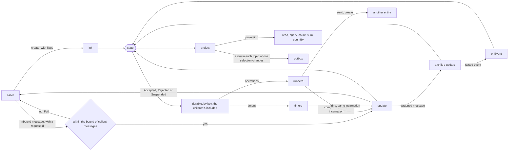
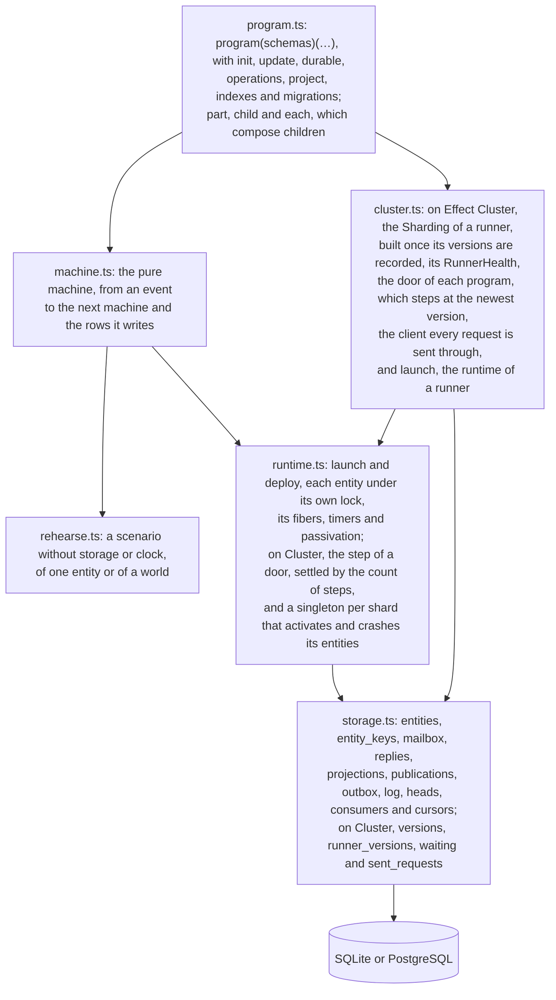

# effect-tea-durable

The Elm architecture for long-lived entities on a server: an order, a booking, a job, each addressed by its id,
whose state survives crashes, restarts and deploys. A program is written as in
[effect-tea](https://github.com/fgaudo/effect-tea), with a pure `update`, and tested without a database, a
cluster or a clock.

An entity keeps one **state**. A pure **`update`** changes it in response to messages. There are no commands:
the work under way — operations, as data, and timers — is derived from the state by **`durable`**, by key, and
answers with messages of the same incarnation. Callers read a **projection**, made from the state, which is
also the row a query reads and what the outbox publishes, by **topic**: a part of the projection, written when it
changes, and read as that part.



## Why

An entity that lives in time, an order waiting for its payment or a booking held until a deadline, has the
costly bugs: a timer that fires after a cancellation, a retry that pays twice, a process that died halfway
through. The code that prevents them is the same for every entity: a request applied once, a timer that survives
a restart, work resumed after a crash with the key a provider needs to act once, an outbox, a version that reads
what the one before stored. This library writes it once, so that a program holds only its use case. A row with
no life of its own, a profile or a product, does not need it.

- **The state is the only truth.** There are no commands and no history to replay: the work under way is derived
  from the state, by `durable`, and a state that holds no timer has no timer. A cancellation is a state change,
  and the timer follows.
- **Time is a value.** A timer is data, derived from the state, and a test fires it instead of waiting for it: a
  deadline a month away is tested as fast as one a second away.
- **A program is read in one place.** `update`, `durable` and `project` are pure functions over data, with
  nothing of storage, locks, retries or timers in them, and the scenarios read as the use case does, crashes
  included. Whoever writes a program can get only the use case wrong, and a type error or a failed scenario says
  so without a database or a clock. What holds where the process may die is checked once, in the library.
- **One model, in the browser and on the server.** A program is written as in effect-tea: who writes the Elm
  architecture for a screen writes it the same way for an order.

**This repository holds a design, its pure core, and a runtime on SQLite or PostgreSQL that runs on one process.** It has:

- [`docs/design.md`](docs/design.md): what the library is for, its model of execution, and what it guarantees
  at each point where the process may die;
- [`src/`](src): the one place a program is declared, with its types and the migrations of its schemas
  ([`src/program.ts`](src/program.ts)), the runtime's semantics as a pure state machine
  ([`src/machine.ts`](src/machine.ts)), which `rehearse` runs and property tests check, and the runtime that
  interprets it over `SqlClient` ([`src/runtime.ts`](src/runtime.ts), [`src/storage.ts`](src/storage.ts)),
  unloading an entity that has nothing to do and waking it from its stored timers, tested by dying at each point
  of the design's crash table and comparing where it ends with the machine
  ([`src/runtime.test.ts`](src/runtime.test.ts));
- [`docs/decisions/`](docs/decisions): one note per decision, with the alternatives it rejected, listed by what
  they decide in [its index](docs/decisions/README.md);
- [`docs/glossary.md`](docs/glossary.md): the words of the design, each defined once;
- [`docs/open-questions.md`](docs/open-questions.md): what is not decided yet;
- [`docs/roadmap.md`](docs/roadmap.md): the steps from this design to a library, in order;
- [`examples/order`](examples/order): an order's lifecycle, with its scenarios as tests, the question a
  query across entities answers — which orders nobody paid, how many, and what they owe — what each of its steps publishes for other
  systems, and a report fed from the log, how many orders are in each status
  ([`examples/order/runtime.test.ts`](examples/order/runtime.test.ts)). If an example reads badly, the
  API is wrong;
- [`examples/subscription`](examples/subscription): a subscription billed every month, which never ends;
- [`examples/cart`](examples/cart): a cart whose lines are children by id, each reserving its own stock;
- [`examples/booking`](examples/booking): a booking that holds seats in an event's inventory, two entities
  that talk, rehearsed and also run on the runtime
  ([`examples/booking/runtime.test.ts`](examples/booking/runtime.test.ts)).

The modules of `src/`, each built on the one above it:



```sh
bun install
bun run typecheck
bun test
```

The name is a working one. The library will be separate from effect-tea, which it shares ideas with but no
code. It depends on Effect's unstable modules, `effect/sql`, `effect/cluster`, `effect/rpc` and `effect/workflow`,
and is released as experimental, not for production, as long as it does: an API that changes under it costs an
update of the runtime, never of the pure core or of a program.

## License

MIT
