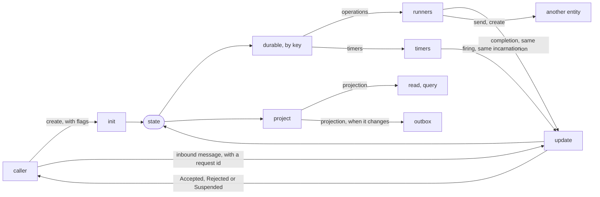
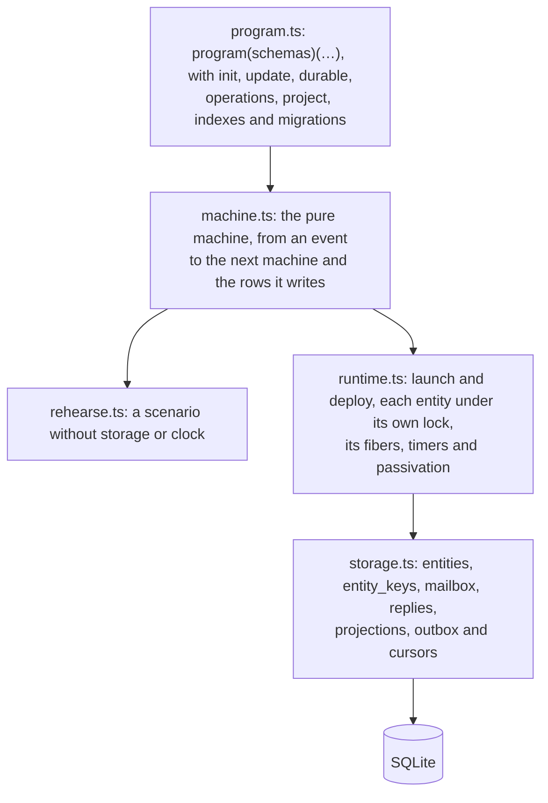

# effect-tea-durable

The Elm architecture for long-lived entities on a server: an order, a booking, a job, each addressed by its id,
whose state survives crashes, restarts and deploys. A program is written as in
[effect-tea](https://github.com/fgaudo/effect-tea), with a pure `update`, and tested without a database, a
cluster or a clock.

An entity keeps one **state**. A pure **`update`** changes it in response to messages. There are no commands:
the work under way — operations, as data, and timers — is derived from the state by **`durable`**, by key, and
answers with messages of the same incarnation. Callers read a **projection**, made from the state, which is
also the row a query reads and what the outbox publishes.



**This repository holds a design, its pure core, and a runtime on SQLite that runs on one process.** It has:

- [`docs/design.md`](docs/design.md): what the library is for, its model of execution, and what it guarantees
  at each point where the process may die;
- [`src/`](src): the one place a program is declared, with its types and the migrations of its schemas
  ([`src/program.ts`](src/program.ts)), the runtime's semantics as a pure state machine
  ([`src/machine.ts`](src/machine.ts)), which `rehearse` runs and property tests check, and the runtime that
  interprets it over `SqlClient` ([`src/runtime.ts`](src/runtime.ts), [`src/storage.ts`](src/storage.ts)),
  unloading an entity that has nothing to do and waking it from its stored timers, tested by dying at each point
  of the design's crash table and comparing where it ends with the machine
  ([`src/runtime.test.ts`](src/runtime.test.ts));
- [`docs/decisions/`](docs/decisions): one note per decision, with the alternatives it rejected, listed by what
  they decide in [its index](docs/decisions/README.md);
- [`docs/open-questions.md`](docs/open-questions.md): what is not decided yet;
- [`docs/roadmap.md`](docs/roadmap.md): the steps from this design to a library, in order;
- [`examples/order`](examples/order): an order's lifecycle, with its scenarios as tests, the question a
  query across entities answers — which orders nobody paid — and what each of its steps publishes for other
  systems ([`examples/order/runtime.test.ts`](examples/order/runtime.test.ts)). If an example reads badly, the
  API is wrong;
- [`examples/subscription`](examples/subscription): a subscription billed every month, which never ends;
- [`examples/booking`](examples/booking): a booking that holds seats in an event's inventory, two entities
  that talk, rehearsed and also run on the runtime
  ([`examples/booking/runtime.test.ts`](examples/booking/runtime.test.ts)).

The modules of `src/`, each built on the one above it:



```sh
bun install
bun run typecheck
bun test
```

The name is a working one. The library will be separate from effect-tea, which it shares ideas with but no
code ([decision 0001](docs/decisions/0001-separate-from-effect-tea.md)).

## License

MIT
