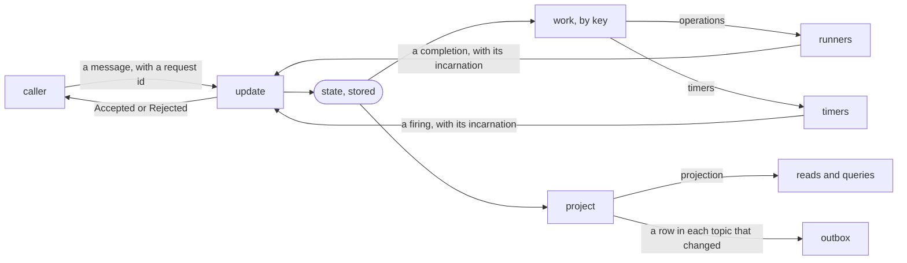

# effect-tea-persistent

Long-lived entities on a server, written as pure functions and stored in SQL. An order that waits for its payment, a
booking held until a deadline and a subscription billed every month are each an entity. An entity is addressed by
its id, and its state survives crashes, restarts and deploys. A program is written in the Elm architecture, as in
[effect-tea](https://github.com/fgaudo/effect-tea), on [Effect](https://effect.website) v4, and is tested without a
database or a clock.

**Experimental, and not published yet.** It runs on one process, on SQLite or PostgreSQL, and on Effect Cluster with
every runner on one machine. It is not for production while it depends on Effect's unstable modules
([status](#status)).

## Contents

- [The problem](#the-problem)
- [How a program is made](#how-a-program-is-made)
- [Trying it](#trying-it) and the [quick start](#quick-start)
- [Why](#why), [what it is not for](#what-it-is-not-for), and how it [compares](#compared-with) with other tools
- [Examples](#examples)
- [Status](#status) and [documentation](#documentation)

## The problem

An order is created, and the customer has fifteen minutes to pay. Code written by hand stores a row with a status
and a deadline, calls the payment provider, and writes the result. Each of these lines fails in a way the happy
path does not show:

- **The process restarts during the fifteen minutes.** A `setTimeout` dies with the process, so the deadline becomes
  a cron that polls the table. A cron that runs while the customer pays cancels a paid order, unless the two take
  the same lock.
- **The process dies after the provider charged the card and before the row says so.** The retry charges the card
  again, unless the first call carried an idempotency key and the retry carries the same one.
- **A charge times out, and is tried again.** The answer of the first attempt arrives late, and the code must tell
  that it belongs to an attempt that no longer counts.
- **A caller retries a request whose reply it never received.** The second request must get the first one's reply,
  and must not be applied twice.

None of this is about orders. This library writes it once, and a program says only what the order does.

## How a program is made

An entity holds one **state**, a value of its program's schema: an order is `AwaitingPayment` with a deadline, then
`Charging`, then `Paid`. A pure function, **`update`**, takes a message and the state, and gives the next state. It
may instead **reject** a message that does not apply in that state, such as a payment of an order already paid. The
runtime stores each next state in one transaction with the reply to the message.

There are no commands. The work under way is derived from the state, by **`work`**, under keys the program names. A
state `AwaitingPayment` holds a timer at its deadline, and a state `Charging` holds an **operation** `Charge`. An
operation is data, which a runner of the program turns into an effect, given an idempotency key that is the same at
every try. Once the state moves on, its timer is gone, and nothing has to cancel it. Each run of work under a key has
an **incarnation**, a number that never goes back. The answer of a charge carries the incarnation of its run, and the
runtime drops an answer whose run is no longer the current one.

Callers read a **projection**, data made from the state, such as `{ status: 'Paid' }`. A query across entities reads
the projection too. The **outbox** publishes it for other systems, by **topic**: a topic is a part of the projection
that a program names, and the outbox gets a row each time that part changes.



**The state is the only truth, and nothing is replayed.** A durable execution engine, such as Temporal or Restate,
stores the history of what a function did, and runs the function again over that history after a crash. Here the
runtime stores the state, reads it back after a crash, and starts the work that `work` derives from it. So the code of
`update` is not replayed against a history, and a change of the state's schema is a migration that reads the version
before. [`docs/design.md`](docs/design.md) says what each piece does, and what holds at each point where the process
may die.

## Trying it

The package is not published yet. Clone the repository, then:

```sh
bun install
bun test examples/quick-start
```

The examples import the library by its name, `@fgaudo/effect-tea-persistent`, which `package.json` resolves to
`src/`, so they run on the sources with no build. The runtime runs on any `SqlClient` of Effect for SQLite or
PostgreSQL. The tests use Bun's SQLite, and PGlite for PostgreSQL.

## Quick start

A seat held for a quarter of an hour, confirmed in time or released when the time runs out. The program is
[`examples/quick-start/hold.ts`](examples/quick-start/hold.ts):

```ts
import * as DateTime from 'effect/DateTime'
import * as Schema from 'effect/Schema'
import { noWork, program, reject, timer } from '@fgaudo/effect-tea-persistent/program'

// A seat held for a quarter of an hour: confirmed in time, or released when the time runs out.
const State = Schema.Union([
  Schema.TaggedStruct('Held', { until: Schema.DateTimeUtcFromMillis }),
  Schema.TaggedStruct('Confirmed', {}),
  Schema.TaggedStruct('Released', {}),
])

export const hold = program({
  state: State,
  flags: Schema.Null,
  inbound: Schema.TaggedStruct('Confirm', {}),
  internal: Schema.TaggedStruct('Expired', {}),
  projection: Schema.Struct({ status: Schema.Literals(['Held', 'Confirmed', 'Released']) }),
})({
  name: 'Hold',
  keys: ['expiry'],
  init: (_, at) => ({ _tag: 'Held', until: DateTime.add(at, { minutes: 15 }) }),
  // `Expired` arrives only while the state holds its timer, so only while the seat is held.
  update: (message) => (state) =>
    message._tag === 'Expired' ? { _tag: 'Released' } : state._tag === 'Held' ? { _tag: 'Confirmed' } : reject,
  // The timer is data, derived from the state: a confirmed seat holds none, and nothing has to cancel it.
  work: (state) => (state._tag === 'Held' ? { expiry: timer(state.until, { _tag: 'Expired' }) } : noWork),
  project: (state) => ({ status: state._tag }),
})
```

Its rehearsal fires the timer without waiting for it, and its launch stores the seat in SQLite, in
[`examples/quick-start/hold.test.ts`](examples/quick-start/hold.test.ts), which `bun test` runs:

```ts
import { SqliteClient } from '@effect/sql-sqlite-bun'
import { expect, test } from 'bun:test'
import * as DateTime from 'effect/DateTime'
import * as Effect from 'effect/Effect'
import { launch } from '@fgaudo/effect-tea-persistent'
import { rehearse, rejected } from '@fgaudo/effect-tea-persistent/testing'
import { hold } from './hold.ts'

// Rehearsed, without a database or a clock: the timer fires because the test fires it.
test('a seat nobody confirms in time is released', () =>
  Effect.runPromise(rehearse(
    hold,
    { flags: null, at: DateTime.makeUnsafe('2026-11-08T10:00:00Z') },
    Effect.fnUntraced(function*(rehearsal) {
      yield* rehearsal.fire('expiry')
      expect(yield* rehearsal.send({ _tag: 'Confirm' }, null)).toMatchObject(rejected)
      expect(yield* rehearsal.projection).toEqual({ status: 'Released' })
    }),
  )))

// Launched on SQLite: the state is stored, and a retry of a request is answered as the first time.
test('a seat confirmed in time is confirmed once', () =>
  Effect.runPromise(Effect.scoped(Effect.gen(function*() {
    const runtime = yield* launch()
    const holds = yield* runtime.deploy(hold)
    yield* holds.create('seat-12', null, { requestId: 'hold-1', sender: null })
    const confirm = { requestId: 'confirm-1', sender: null }
    expect(yield* holds.send('seat-12', { _tag: 'Confirm' }, confirm)).toEqual({ _tag: 'Accepted' })
    expect(yield* holds.send('seat-12', { _tag: 'Confirm' }, confirm)).toEqual({ _tag: 'Accepted' })
    expect(yield* holds.read('seat-12')).toEqual({ status: 'Confirmed' })
  })).pipe(Effect.provide(SqliteClient.layer({ filename: ':memory:' })))))
```

An operation, the work a program asks of the world with an idempotency key, is shown by
[`examples/order`](examples/order). [The guide](docs/guide/README.md) writes a program from a requirement, one
piece at a time.

## Why

An entity that lives in time, an order waiting for its payment or a booking held until a deadline, has the
costly bugs: a timer that fires after a cancellation, a retry that pays twice, a process that died halfway
through. The code that prevents them is the same for every entity: a request applied once, a timer that survives
a restart, work resumed after a crash with the key a provider needs to act once, an outbox, a version that reads
what the one before stored. This library writes it once, so that a program holds only its use case.

- **The state is the only truth.** There are no commands and no history to replay: the work under way is derived
  from the state, by `work`, and a state that holds no timer has no timer. A cancellation is a state change,
  and the timer follows.
- **Time is a value.** A timer is data, derived from the state, and a test fires it instead of waiting for it: a
  deadline a month away is tested as fast as one a second away.
- **A program is read in one place.** `update`, `work` and `project` are pure functions over data, with
  nothing of storage, locks, retries or timers in them, and the scenarios read as the use case does, crashes
  included. Whoever writes a program can get only the use case wrong, and a type error or a failed scenario says
  so without a database or a clock. What holds where the process may die is checked once, in the library.
- **One model, in the browser and on the server.** A program is written as in effect-tea: who writes the Elm
  architecture for a screen writes it the same way for an order. [`src/program.ts`](src/program.ts) imports no
  module of Node or of Bun, so a browser imports a program's schemas from it
  ([decision 0192](docs/decisions/0192-the-digest-of-a-key-is-computed-by-the-machine.md)).

## What it is not for

- **A row with no life of its own**, such as a profile or a product. A request handler and a table already serve it,
  with Effect's HTTP and SQL modules. Such a table may live in the runtime's database, under a name that does not
  start with `tea_`, which the runtime keeps for its own tables.
- **A reply that carries data.** A reply says whether a message applied, or why it did not. A caller reads the
  projection after, and an entity that needs a value of another one receives it in the message itself.
- **Entities spread across machines.** On Effect Cluster every runner shares one file of SQLite, so the runners are
  on one machine, until Cluster has a fence
  ([Effect-TS/effect#10058](https://github.com/Effect-TS/effect/issues/10058)).
- **One entity under a high rate of messages.** An entity handles one message at a time, and each message is one
  transaction, so one entity goes no faster than the database commits.
- **Production**, while the library is experimental.

## Compared with

- **[Temporal](https://temporal.io)** stores the history of a workflow, and replays the workflow's code over it, so
  that code must be deterministic. Here the state is stored, nothing is replayed, and no server runs beside the
  database.
- **[Restate](https://restate.dev)** journals each step of a handler, and replays the handler over its journal, on a
  server of its own. Its virtual objects are the closest idea, an entity by key with one call at a time. Here the
  entity is a state machine, not a function that resumes.
- **[Akka Persistence](https://akka.io)** rebuilds an
  event-sourced actor by replaying its events, on the JVM. Here the state after each message is what is stored, and
  the timers and the work are derived from it.
- **Effect's `effect/workflow`** replays the stored results of a workflow's activities, in Effect, as Temporal does.
  Here a program is written as effect-tea's are, and is tested as pure functions.
- **A cron over a table** polls rows by their status. The lock between the cron and the requests, the idempotency
  keys, the retries, and the crash between a call and its record are each written by hand, for each table.

## Examples

Each example is a program with its scenarios as tests. If an example reads badly, the API is wrong.

| Example                                      | What it is                                  | What it shows                                                                                                                 |
| -------------------------------------------- | ------------------------------------------- | ----------------------------------------------------------------------------------------------------------------------------- |
| [`quick-start`](examples/quick-start)        | a seat held until a deadline                | a state, a timer derived from it, a rejection, a rehearsal, a launch on SQLite                                               |
| [`order`](examples/order)                    | an order, from its payment to its shipment  | operations with idempotency keys, an email sent at most once, a query across orders, topics of the outbox, a report from the log, a runner of Effect Cluster |
| [`subscription`](examples/subscription)      | a subscription billed every month           | a timer that repeats, a declined charge tried again behind a timer, with its attempts counted in the state                   |
| [`cart`](examples/cart)                      | a cart whose lines reserve their stock      | children by id, each with work of its own                                                                                     |
| [`booking`](examples/booking)                | a booking that holds seats of an event      | two entities that talk, rehearsed together and run on the runtime                                                             |
| [`rental`](examples/rental)                  | bikes rented by the minute                  | the guide's running example: a value sent with the request and refused once changed, an id derived from the request id, an email carried into the end, a window a timer closes, a table of the application, a migration, a ride suspended and resumed by a fix |
| [`server`](examples/server)                  | the orders served over HTTP                 | a runner of Effect Cluster as a process, killed during a charge and started again; two runners on one file                   |

## Status

The library is experimental, as long as it depends on Effect's unstable modules `effect/sql`, `effect/cluster` and
`effect/rpc` ([decision 0099](docs/decisions/archive/0099-a-library-on-unstable-modules-is-released-as-experimental.md)).
An API that changes under it costs an update of the runtime, never of the pure core or of a program. It pins Effect
4.1.2.

- **What runs:** a program and its rehearsals, the runtime on one process on SQLite or PostgreSQL, and the runtime on
  Effect Cluster with its runners on one machine.
- **What does not yet:** a published package, a site with the API's reference, and the runtime on Cluster across
  machines. [`docs/roadmap.md`](docs/roadmap.md) lists the steps in order.

## Documentation

- [`docs/guide/README.md`](docs/guide/README.md): the guide, from a requirement to a program, on the rental of
  bikes. Read it first. Its pages by topic, on children, the outbox, schemas that change, Effect Cluster and the
  operator's calls, are read when a program needs them.
- [`docs/design.md`](docs/design.md): the specification. It says what each piece of a program does, how the runtime
  runs it, and what holds at each point where the process may die.
- [`docs/glossary.md`](docs/glossary.md): the words of the design, each defined once.
- [`CONTRIBUTING.md`](CONTRIBUTING.md): the documents, the modules of `src/` and the tables of the storage, and how
  the repository is checked.

## License

[MIT](LICENSE) © Francesco Gaudenzi
