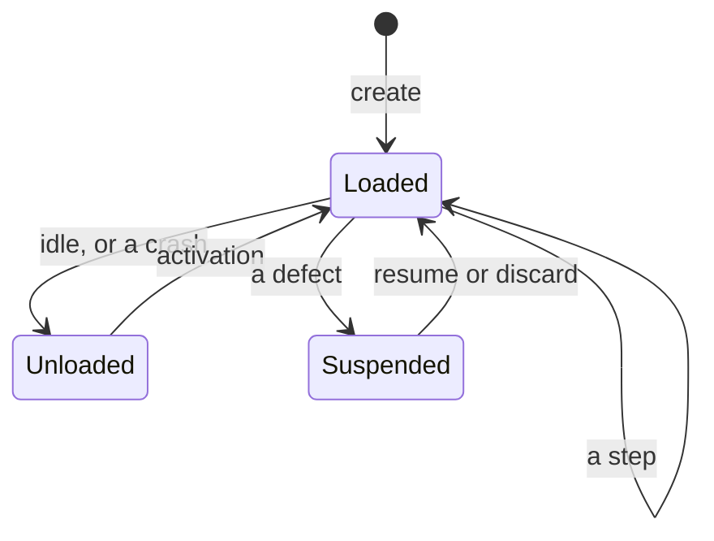

# Concepts at a glance

This page shows on one screen the pieces of a program, what each call answers, and the life of an entity. It is a
map, not a rule book. Each line links the section of [`design.md`](design.md) that says the rule in full, and the
words in bold are defined in [`glossary.md`](glossary.md). [The guide](guide/README.md) writes a program from a
requirement with these pieces.

## The pieces of a program

A program is declared in one call, `program(schemas)(pieces)`. The schemas come first, and give every type the
pieces are written in.

| Piece        | Its form                                                    | What it gives                                                                  |
| ------------ | ----------------------------------------------------------- | ------------------------------------------------------------------------------ |
| `name`       | a string                                                    | what the runtime stores the entities under                                     |
| `keys`       | `['expiry', key('charge', Schema.String)]`                  | every key the work under way is held under                                     |
| `init`       | `(flags, at) => state` or a rejection                       | the first **state**, from the **flags** and the time of the creation           |
| `update`     | `(message, { from, at }) => (state) => next state`          | the next state, `reject`, `rejectWith(reason)` or `defect(text)`               |
| `work`       | `(state) => ({ key: piece of work })`, or `noWork`          | the **operations** and **timers** each state holds, by **key**                 |
| `operations` | `{ Tag: operation(run) }`                                   | the **runner** of each kind of operation, with its **delivery**                |
| `project`    | `(state) => projection`                                     | the **projection** callers read, as JSON                                       |
| `indexes`    | `{ name: (projection) => scalar }`                          | what a query across entities filters and orders by                             |
| `topics`     | `{ name: (projection) => JSON }`                            | the parts of the projection the **outbox** publishes                           |
| `migrations` | a list, each a record of pure functions on JSON, by kind     | how this version reads what the versions before it stored                      |
| `children`   | `{ Name: child(part, { at }) }` or `each(part, { id, at })` | the **parts** the state holds, with `onEvent` for what they raise              |

A program leaves out what it does not have: `keys`, `work` and `operations` for a program with no work, `update`
for one with no message of its own. [A program](design.md#a-program) says what each piece left out is.

## The work a state holds

| Piece of work                          | What it does                                                                     | What a crash does to it                          |
| -------------------------------------- | -------------------------------------------------------------------------------- | ------------------------------------------------ |
| `timer(at, message)`                   | delivers `message` once `at` has passed                                          | it is armed again from the stored state          |
| `operation(run)`                       | runs `run(operation, key)`, which passes the **idempotency key** to its service  | it runs again, with the same idempotency key     |
| `operation.digest(run)`                | as above, with the key's SHA-256, for a service that caps a key's length         | it runs again, with the same digest              |
| `operation.atLeastOnce(run)`           | runs `run(operation)`, as a request to another entity                            | it runs again                                    |
| `operation.atMostOnce(run, unknown)`   | runs `run(operation)`, as an email a second copy of is worse than none            | it is not run again, and `unknown` is delivered  |
| `operation.droppable(run)`             | runs a computation or a read, which acts on nothing                              | it runs again                                    |

Each run of work under a key has an **incarnation**. The runtime drops an answer whose incarnation is no longer the
current one, so a late answer of a first attempt never reaches the second. [Work](design.md#work) says the rules.

## What each call answers

| Call     | Answers                                                         | Means                                                                                     |
| -------- | --------------------------------------------------------------- | ----------------------------------------------------------------------------------------- |
| `create` | `Created`                                                       | the entity exists; a retry of the same request is answered `Created` again                |
|          | `AlreadyExists`                                                 | another request created an entity with that id                                            |
|          | `Rejected`, with a reason or `null`                             | `init` rejected the flags, and nothing is stored                                          |
| `send`   | `Accepted`                                                      | the message is applied, once, whichever retry finds the stored reply                      |
|          | `Rejected`, with a reason or `null`                             | `update` rejected the message, and the state did not change                               |
|          | `NotFound`                                                      | no entity has that id, and nothing is created                                             |
|          | `Suspended`                                                     | the entity is suspended, and the request has no reply yet: retry under the same request id |
|          | `Full`                                                          | the entity holds `callers.messages` messages already, and nothing is stored               |
| `read`   | the projection, or `null`                                       | what the last step that changed the state wrote                                           |
| `resume` | `Resumed`, `StillSuspended`, `NotSuspended` or `NotFound`       | what the operator's own resumption did                                                    |
| `discard`| `Discarded`, `NotDiscarded`, `StillSuspended`, `NotSuspended` or `NotFound` | what the operator's own discard did                                           |

A reply carries no data. A caller learns what a message did by reading the projection after it.
[Messages](design.md#messages) and [Defects](design.md#defects) say the rules.

## Who calls what

`deploy(program)` gives a **handle** to one program's entities. Each call of the handle is made by one of three
people:

- **A caller**, through the **boundary**: `create`, `send`, `read`, `query`, `count`, `sum` and `countBy`
  ([Reading](design.md#reading)).
- **A consumer of the outbox**: `fetch`, `ack`, `consume`, `published`, `consumers`, `prune` and `forget`
  ([Publishing what happened](design.md#publishing-what-happened)).
- **An operator**: `check`, `suspended`, `inspect`, `resume`, `discard`, `reindex` and `expire`
  ([the operator's calls](guide/operator.md)).

A test calls none of them. It calls `rehearse`, which runs the program without a database or a clock
([Testing](design.md#testing)).

## The life of an entity

- **Created.** `create` runs `init` on the flags. An entity whose flags `init` rejects is never stored.
- **Loaded.** The entity is in the process, and handles one message at a time: a caller's message, an operation's
  completion or a timer's firing. Each **step** is one transaction, which stores the next state with its reply. Then
  the runtime starts the work of each new key, and ends the work of each key that left the state.
- **Unloaded.** Nothing of the entity is in memory, and everything it needs is stored. An entity is unloaded when it
  has had nothing to do for a while, when the process is over its **capacity**, or by a crash. The earliest of its
  stored timers wakes it, and so does the next message. Its **activation** reads the state back, computes
  `work(state)` again, and starts what the state holds. Nothing is replayed.
- **Suspended.** A **defect** stopped the entity. Its state stays as it was before the message, and the message
  stays first in its mailbox. Its timers are disarmed, and its operations under way run to their end. Every caller
  is answered `Suspended` until an operator resumes it, once a fix is deployed, or discards the message. A suspended
  entity may be unloaded, and stays suspended.

[Execution](design.md#execution) says when an entity is loaded and unloaded, and
[what survives a crash](design.md#what-survives-a-crash) says what holds at each point where the process may die.
