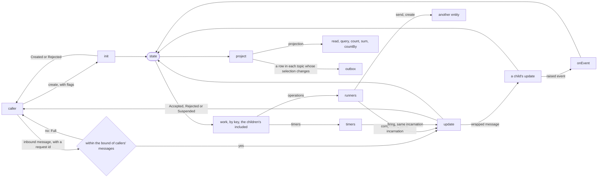

# Design

This is the specification of the library: what each piece of a program does, how the runtime runs it, and what
holds at each point where the process may die. The words it uses are defined in [`glossary.md`](glossary.md), and
[`concepts.md`](concepts.md) shows the pieces and the life of an entity on one page.

## In brief

- **An entity** is one long-lived thing with an id, such as an order. It holds one **state**, and handles one
  message at a time.
- **`update`** is a pure function from a message and the state to the next state. It rejects an inbound message
  that does not apply, and answers an internal message that cannot arrive with a defect.
- **Each step is one transaction.** The runtime stores the next state with the reply to the message, the row
  callers read and the rows of the outbox.
- **There are no commands.** `work(state)` derives the operations and the timers under way from the state, by key.
  A key that leaves the state ends its work, and nothing has to cancel it.
- **An operation is data.** Its runner turns it into an effect, and declares what a crash does to it. An idempotent
  one is given the same idempotency key at every try.
- **An incarnation** numbers each run of the work under a key. The runtime drops an answer of a run that is no
  longer the current one.
- **Callers read the projection**, JSON made from the state. A query across entities reads its indexes, and the
  outbox publishes its topics.
- **A defect suspends the entity**, with its state and its message kept, until an operator resumes it with a fix
  or discards the message.
- **Nothing is replayed.** After a crash the runtime reads the state back and starts the work `work` derives from
  it. A new version of a schema reads the version before through a migration.
- **A program is tested without a database or a clock.** A rehearsal runs the runtime's machine, and the test
  decides when each operation answers and when time passes.

## Contents

The sections up to [Where it runs](#where-it-runs) are the contract: what a program, its boundary, its tests and an
operator rely on. The last section, [How the runtime keeps it](#how-the-runtime-keeps-it), is for whoever changes
the runtime.

- [What it is for](#what-it-is-for)
- [A program](#a-program), with its [children](#children)
- [Messages](#messages)
- [Work](#work): [keys with a parameter](#keys-with-a-parameter), [incarnations](#incarnations) and
  [entities that talk](#entities-that-talk)
- [Persistence](#persistence): [what a step costs](#what-a-step-costs) and [the tables](#the-tables)
- [Schemas that change](#schemas-that-change): [checking a program before its deploy](#checking-a-program-before-its-deploy)
  and [renaming a program](#renaming-a-program)
- [Execution](#execution) and [what survives a crash](#what-survives-a-crash)
- [Defects](#defects)
- [Reading](#reading)
- [Publishing what happened](#publishing-what-happened): [topics](#topics), [the order of the log](#the-order-of-the-log),
  [consumers](#consumers), [readers of one consumer](#readers-of-one-consumer),
  [declared consumers](#declared-consumers), [the sweep](#the-sweep) and [what a step publishes](#what-a-step-publishes)
- [Testing](#testing): [the tests of a program](#the-tests-of-a-program), [rehearsing](#rehearsing) and
  [rehearsing a world](#rehearsing-a-world)
- [Where it departs from effect-tea](#where-it-departs-from-effect-tea)
- [Where it runs](#where-it-runs): [databases](#databases), [entities in the process](#entities-in-the-process),
  [deployments](#deployments), [a planned stop](#a-planned-stop), [what a tracer sees](#what-a-tracer-sees),
  [on Effect Cluster](#on-effect-cluster) and [the public surface](#the-public-surface)
- [How the runtime keeps it](#how-the-runtime-keeps-it): [what the storage writes](#what-the-storage-writes),
  [fibers and locks](#fibers-and-locks), [Effect Cluster inside the runtime](#effect-cluster-inside-the-runtime) and
  [how the machine and the runtime are tested](#how-the-machine-and-the-runtime-are-tested)

## What it is for

A server holds two kinds of state:

- **Rows that requests read and write**, with no life of their own: a profile, a product in a catalogue. A
  request handler is a function from the request to an effect, and the database keeps the state. This library
  is not for them: Effect's HTTP modules already are.
- **Entities that live in time**, whose state changes with events from outside and with the passing of time: an
  order waiting for its payment, a booking held until a deadline, a job with steps and retries. Their bugs are
  the costly ones: a timer that fires after a cancellation, a payment taken twice, a process that died halfway
  through. This library is for them.

An entity is addressed by its id, handles one message at a time, and its state survives crashes, restarts and
deploys. Its program is written as in effect-tea: a pure `update`, states that say which operation is under
way, `reject` for what may arrive and does not apply, a defect for what cannot arrive.

The same intuition is behind Erlang's `gen_server`, Akka Persistence and Restate's virtual objects. What this
library adds is effect-tea's discipline: everything that matters is in the state, and every behaviour is
tested by calling pure functions, crashes included.

## A program

| Piece        | What it does                                                                              |
| ------------ | ----------------------------------------------------------------------------------------- |
| `schemas`    | `state`, `flags`, `inbound`, `internal`, `operation`, `rejection`, `sender`, `projection` |
| `name`       | what the runtime stores the entity under, and what other entities see it as               |
| `keys`       | every key the work under way is held under: a name, or `key` with its parameter's schema |
| `init`       | the first state, from the flags and the time of the creation, or a rejection of the flags |
| `update`     | `(message, meta, children) => (state) =>` the next state, a rejection, or a defect        |
| `work`       | the work under way in each state, by key: operations, as data, and timers                 |
| `operations` | how each kind of operation runs, what it answers, and what a crash does to it             |
| `project`    | what callers read of the state, with the actions it allows, from the children's too       |
| `topics`     | the parts of the projection the log publishes, by name, each selected from it as JSON    |
| `children`   | the parts the state holds, each placed with `child` or `each`                             |
| `onEvent`    | what the program does with each event a child raises                                      |
| `indexes`    | what a query across the program's entities filters and orders by, read off the projection |
| `migrations` | how the versions before this one are read, in order                                       |

An entity's loop runs every piece of the table, with its children and the bound of callers' messages:

A program is declared in one place, `program(schemas)(…)`: the schemas first, which give every type the program
is written in, and then what it does. Everything else is inferred from the pieces — the keys `work` may use,
the messages each kind of operation answers, the names a query may order by, and the services the operations run
in ([decision 0035](decisions/archive/0035-one-place-where-a-program-is-declared.md)).

A program leaves out what it does not have, and each piece left out is empty
([decision 0180](decisions/0180-a-program-leaves-out-what-it-does-not-have.md)). The schemas of the internal
messages, the operations and the reasons left out are `Schema.Never`, and the sender's is `Schema.Null`. `keys`
left out is `[]`, and `operations` and `indexes` left out are `{}`. `work` may be left out only where no key is declared, and
`operations` only where there is no kind of operation, so a program that holds work says what work it holds.
`update` may be left out only where there is no own message, inbound or internal, and leaves the state as it is
then ([decision 0202](decisions/0202-update-is-left-out-where-there-is-no-own-message.md)). A parent whose only
messages are its children's still gives `inbound: Schema.Never`.

There are no commands. Every piece of work that must survive a crash is derived from the state by `work`
([decision 0003](decisions/archive/0003-durable-work-derived-from-state.md)). An operation is data, as effect-tea's
commands are, and its runner sees it, never the state
([decision 0018](decisions/archive/0018-operations-are-data.md)). Everything that leaves the process has a schema: what
is stored, and the projection callers read
([decision 0025](decisions/archive/0025-operations-and-projections-have-schemas.md)), and each of them encodes to what
JSON holds ([decision 0030](decisions/archive/0030-a-schema-encodes-to-json.md)). A program gives the schema of its
senders too: a queued message's origin is stored through it, so a message handled after a restart keeps who sent
it ([decision 0027](decisions/archive/0027-a-program-gives-the-schema-of-its-senders.md)).

A state is an object, as in the Guide ([decision 0031](decisions/archive/0031-a-state-is-an-object.md)). A tag is no rule
of the types, and the Guide's one state machine per concern is how the examples are written: it is also what
gives `work` and `project` a case to match on.

Nothing that crosses the library is mutated: the program and its schemas, its states, flags, messages,
operations, timers and projections, and what the library gives back. A new value is a new object, as the Guide
says of a state. The library relies on it — a step whose next state is the same object stores nothing callers
read, and an operation changed in place is never seen to change — and, as for purity, checks nothing of it
([decision 0052](decisions/archive/0052-what-crosses-the-library-is-never-mutated.md)).

A program is checked where it enters — `deploy`, which a fix is too, and `rehearse` — before anything is stored
or run: one whose name is empty, or one of whose indexes is not a word, is refused. The check is pure and made
once, since a program is never mutated
([decision 0054](decisions/archive/0054-a-program-is-checked-where-it-enters.md),
[decision 0136](decisions/archive/0136-a-key-is-a-name-and-a-parameter-as-data.md)).

A program's types are what `Handle`, `Rehearsal` and `Published` take. `TypesOf<typeof p>` gives them, of the program
or of a reference to it, so a boundary names the handle it launched as `Handle<TypesOf<typeof order>>`
([decision 0188](decisions/0188-typesof-gives-a-programs-types.md)).

[`examples/order/order.ts`](../examples/order/order.ts) is a whole program.

## Children

A program may hold children inside its entity, as effect-tea's parent does, stored in its one state
([decision 0133](decisions/archive/0133-an-entity-composes-children-as-effect-tea-does.md)). The library routes each child's
messages, holds its work under its keys, lifts its runners and wraps its reasons, so the composed program is a
program the machine takes as any other. [`examples/cart`](../examples/cart) holds a line of a cart for each article.

### A part

A child is a part, `part(schemas)(…)`: a program's pieces without a name, indexes or migrations, which are the
parent's. Its schemas are a program's, and the sender it reads when it reads one. It leaves out what a program does. A part may also give two schemas
that only type it, since nothing stores what they describe:

- **`event`**, what it raises for its parent. Its `update` returns `raise(event)(state)`, and the parent's
  `onEvent` handles the raised event in the same step.
- **`external`**, what only its parent sends it. An external message is no inbound one: a caller cannot send it,
  so a fact the parent hands down as one truth, a checkout, reaches the child from the parent alone.

A part may hold children of its own, so a tree is as deep as a program needs.

### Declaring children

- **`children`** holds each child: `child(part, { at })` where an optic of Effect focuses, and
  `each(part, { id, at })` for children by id, as the entries an optic focuses, such as
  `Optic.id<State>().key('lines').compose(Optic.entries())`. An id has a schema, and two ids are one when they
  encode alike, as the parameters of a key are.
- **`update`** takes the parent's own messages, `meta`, and `children`: `children.Line.update(id, message)` sends a
  child an external message, and returns the parent's step. A child that rejects it, or is not there, is a defect.
  `andThen` and `forEach` add up the steps of a parent that is itself a part, keeping their raised events.
  `forEach` over messages to children of one name by id puts the children back once, and not once per child, with
  the same step as one message after the other gives. A child that raises an event puts them back before its parent
  handles it ([decision 0155](decisions/archive/0155-a-foreach-of-messages-to-children-puts-them-back-once.md)).
  One `andThen` after the other puts the children back once per message, since `andThen` gives its state at once.
  A step that tells many children is therefore written with `forEach`, over the ids, or over the steps already made
  with `(step) => step` ([decision 0240](decisions/0240-a-step-that-tells-many-children-is-written-with-foreach.md)).
- **`onEvent`** has a handler for each child that raises events, and is required exactly when one does. A handler of
  children by id takes the id first.
- **`project`** takes `children`, with each child's projection: `children.Line(state, id)`.
- **`init`** makes the whole state, and starts a child with the child's own `init`. A part's `init` never rejects:
  the parent calls it, and decides in its own `init` or `update` whether the child starts
  ([decision 0182](decisions/0182-init-may-reject-the-flags.md)).

### What the library derives

- **Messages.** The parent's inbound and internal messages are its own and each child's, as
  `{ _tag: <child>, message }`, with `id` for a child by id. `meta.from` reaches the child as it reached the parent.
  An inbound message to a child that is not there is rejected.
- **Keys.** A child's key is the parent's under `<child>.<key>`. A key of a child by id takes the id as parameter,
  or the id and the key's own parameter as a pair.
- **Operations.** A child's operation is the parent's under the tag `<child>.<tag>`, as
  `{ _tag: 'Line.Reserve', id, operation }`, run by the child's runner with its delivery.
- **Reasons.** A reason a child gives reaches the caller as `{ _tag: <child>, id, reason }`.

A name with a `.` is composition's: a parent whose own key, operation or child has one is refused where it is
declared. A child's name is composition's too. A parent's own message or reason whose `_tag` may be a child's name
does not compile, nor an own operation whose `_tag` may be `<child>.<tag>`. A tag typed `string`, a template that
reaches a child's name, and a schema with no `_tag` that takes any, as a record, are refused alike. The composed
schemas try each child's wrapper before the parent's own schema, and the own schema refuses a value tagged as a
child's, so a cast past the compiler fails where the value is encoded or decoded, and no field is dropped
([decision 0270](decisions/0270-a-childs-name-is-never-an-own-tag.md)). A child that leaves the state with an operation under way is a defect, as any key dropped while its
operation runs. A child that asks its parent to drop it leaves its work first, from a state that holds none: work a
state still holds after its completion runs again, so a parent that kept the child would run it twice. A child by id removed and added again comes back under new incarnations, so an answer of its earlier
run is dropped.

### Where an item goes

An item is inside the entity when a rule holds across it and the rest within one step. It is an entity of its own
when others address it, or when its parent would hold more than one step should write. Inside the entity, it is a
child when it is a concern of its own, which the parent hears of through its raised events and never reads to
decide. Otherwise it is the parent's own state. A parent's step lists the work of every child that is there, so a
step costs more with every child (see [what a step costs](#what-a-step-costs)).

## Messages

A message is one of two kinds, and the rule for a message that does not apply follows from its kind.

- **Inbound** messages come from callers. Each one carries a request id chosen by the caller, and is answered
  `Accepted` or `Rejected`, with the reason `update` gave, if any
  ([decision 0010](decisions/archive/0010-a-rejection-may-carry-a-reason.md)). A caller that retries with the same id
  gets the same answer, and the message is applied once. The boundary gives `send` a `keep`, the time its
  protocol retries for, and `keep` is required, since only the boundary knows that time. The reply is then kept for
  that time from the step that answers, and a retry after it is a new request, applied again. A `keep` of
  `'forever'` keeps the reply for ever. A step that stores a reply deletes its entity's replies past their time, and
  `Handle.expire` those of the whole program, which [the sweep](#the-sweep) runs at an interval
  ([decisions 0125](decisions/archive/0125-a-callers-reply-is-kept-as-long-as-its-boundary-says.md),
  [0245](decisions/0245-a-reply-is-kept-as-long-as-send-says-and-the-runtime-sweeps.md)). A program whose sender is
  `null` takes none, and its callers' requests leave the sender out. Request ids are their
  sender's: another entity's are
  stored under its address, apart from everyone else's
  ([decision 0015](decisions/archive/0015-a-request-belongs-to-its-sender.md)), and a caller's under its sender, as the
  program's schema writes it ([decision 0048](decisions/archive/0048-a-callers-request-belongs-to-its-sender.md)). A
  request is a value — a caller's sender and request id, or the run of another entity's operation and the name it
  gave — stored as its schema writes it, and never parsed out of a string
  ([decision 0059](decisions/archive/0059-a-request-is-a-value.md)).
  A caller's request carries its message too. A second request under a caller's sender and request id is a retry
  only where its message, as the `inbound` schema encodes it with the fields of each object in order, is the same
  text. One that carries another message is answered `Reused`: nothing of it is applied, queued or stored, and the
  first request's reply is kept. So a value whose encoding keeps the order it was built in, as a set, is the same
  request only built alike, and a retry decoded from the same request is. A reply another version stored is
  compared once read through the migrations of `inbound`. A boundary answers `Reused` as a refusal of the caller's
  request, as `422` over HTTP. A program whose sender is `null` keeps one space of request ids for every caller, so
  its boundary gives request ids unique across its callers, as a UUID each. A request after a reply's `keep` is a
  new request, whatever it carries
  ([decision 0269](decisions/0269-a-callers-request-is-its-sender-its-id-and-what-it-carries.md)).
  `meta.from` says who sent it, read off the request, so that
  `update` decides who may do what. An inbound message may arrive in any state: a slow client, a retry, a second
  device, a malicious caller. One that does not apply is rejected.
  The runtime trusts the sender it is given: whoever calls `create` and `send` is the boundary, which
  authenticates the caller and writes the sender as the identity it authenticated. A caller the boundary does not
  authenticate never reaches the runtime, and nothing is stored for it. What a sender may do is domain, so a sender
  that may not is rejected, never a defect
  ([decision 0124](decisions/archive/0124-the-boundary-authenticates-and-update-authorizes.md)).
  A caller may be another entity's operation: `meta.from` is then `Entity`, with the sender's name and id,
  filled in by the runtime (see [entities that talk](#entities-that-talk)).
- **Internal** messages come from the entity's own work: an operation's completion, a timer's firing.
  The runtime delivers one only while its key is in `work(state)`, in the same incarnation that sent it
  ([decision 0004](decisions/archive/0004-incarnations-guard-internal-messages.md)). So an internal message in a state
  where its key is absent cannot arrive. `update` answers it with a defect.

`meta.at` is the time the runtime handles the message, read once, before `update`. A program that needs time
reads it there, and `update` stays pure. A timer's message is the fact that its time has passed: `update`
trusts it, and never compares `meta.at` with the deadline. Another node's clock may be a few milliseconds
behind.

An entity is created by a request of its own, with its flags, answered `Created` once and `AlreadyExists`
after, or `Rejected` where its program's `init` rejects the flags, as the paragraph after this one says. The flags
are stored with the entity, and a caller's retry of the creation that carries other flags is answered `Reused`, as
a message is ([decision 0269](decisions/0269-a-callers-request-is-its-sender-its-id-and-what-it-carries.md)). A
message to an entity that does not exist is answered `NotFound`, and creates nothing
([decision 0012](decisions/archive/0012-creation-is-a-request-of-its-own.md),
[decision 0017](decisions/archive/0017-creation-in-the-machine.md)). A caller gives the flags in the request, as
`create(id, { flags, requestId, sender })`, and a program whose flags are `null` leaves them out
([decision 0245](decisions/0245-a-reply-is-kept-as-long-as-send-says-and-the-runtime-sweeps.md)). A creation and a message may share a request id,
and each is answered apart ([decision 0050](decisions/archive/0050-a-creation-is-answered-apart-from-a-message.md)). `init`
sees no sender, so the program does not decide who may create an entity. The boundary decides it, or an entity
does: the entity's `update` rejects the request, or keeps work whose operation calls `create`. A defect at creation
is given to its creator, and nothing is stored, so a retry after a fix creates the entity
([decision 0124](decisions/archive/0124-the-boundary-authenticates-and-update-authorizes.md)).

A program's `init` may reject the flags, with `reject` or `rejectWith` and the program's reasons, as `update`
rejects a message. A rule of the domain at creation that the flags' schema cannot hold, such as one that reads the
time of the creation, lives there. The creator is answered `Rejected`, with the reason. The runtime stores neither
the entity nor the reply: a retry under the same request id runs `init` again, as a message answered `NotFound` is
applied once its entity exists. On Cluster, Cluster saves the door's answer, and the creator's client resets a saved
`Rejected` before it sends the creation, so that a retry is delivered again
([decision 0182](decisions/0182-init-may-reject-the-flags.md)). Another entity's operation is the exception: its
rejection is kept while its work holds, so that a run after a crash is given it again, as
[entities that talk](#entities-that-talk) says.

## Work

`work(state)` returns the work of the state, under the keys the program declares and no others: the names of
the keys are finite, and a name a program computes is not one of them
([decision 0033](decisions/archive/0033-a-program-declares-its-keys.md)). A key may take a parameter, which is data,
as the subsections below say. The types catch a key never declared; a
declared key beside a misspelt one they accept, so the machine checks what `work` returns against `keys`
wherever it reads it, and a key the program does not declare is a defect
([decision 0037](decisions/archive/0037-the-machine-checks-the-declared-keys.md)). So is an operation the program gives
no runner for, which a cast lets through
([decision 0054](decisions/archive/0054-a-program-is-checked-where-it-enters.md)). The runtime compares the work with
the previous state's, as effect-tea compares subscriptions:

- a new key starts its work;
- a kept key leaves it as it is;
- a missing key ends it.

Work ends when its message is handled. In the step that handles it, its key counts as gone, so a next state
that returns it starts new work: that is how a timer repeats
([decision 0008](decisions/archive/0008-delivered-work-is-done.md)).

Two kinds of work exist.

- **An operation** is a value of the program's own type, usually a `Schema.TaggedUnion`, which says what to do.
  The program's `operations` give a runner for each tag, which turns it into an effect that ends with one of the
  internal messages its kind of operation answers
  ([decision 0034](decisions/archive/0034-an-operation-answers-the-messages-of-its-runner.md)). Expected failures become
  messages, as in effect-tea's commands. A transient failure is retried inside the runner, with `Effect.retry` and
  a schedule that ends, under the same idempotency key. Once the schedule ends, the runner delivers a message
  that says so, and the state decides what follows: a new attempt behind a timer, with a count of attempts the
  state holds, or an end. The runtime counts no retries, and never makes a defect of them
  ([decision 0130](decisions/archive/0130-a-runner-retries-and-the-state-counts-the-attempts.md)). The runner says what a
  crash does to it
  ([decision 0011](decisions/archive/0011-an-operation-declares-what-a-crash-does.md)): an idempotent
  one receives an **idempotency key** (the entity's program and id, the operation's key and its incarnation:
  [decision 0015](decisions/archive/0015-a-request-belongs-to-its-sender.md)), and passes it on; one that may
  act twice runs again; one that must act at most once is not run again after a crash, and delivers its
  `unknown` message.
  A restarted operation gets the same idempotency key. A new attempt in a later incarnation gets another. A
  service that caps a key's length gets its digest: a runner declared with `operation.digest` is given the SHA-256
  of the key, in 43 characters of base64url. The key's form is part of the delivery stored with the operation, so a
  deploy cannot change it under an operation under way
  ([decision 0123](decisions/archive/0123-an-idempotent-runner-may-be-given-the-digest-of-its-key.md)). An
  operation leaves the state only through its completion: a step whose next state drops the key of an operation
  still running is a defect ([decision 0005](decisions/archive/0005-an-operation-leaves-only-by-completing.md)).
  A droppable operation, declared with `operation.droppable`, is the exception. It acts on nothing, a computation
  or a read, so a step may drop it or change it while it runs: the runtime interrupts it without waiting for its
  finalizers, and a change starts it again as new work. A crash runs it again. It sends to no entity and creates
  none, since a request acts on its receiver: one that does dies
  ([decision 0128](decisions/archive/0128-an-operation-that-acts-on-nothing-may-be-dropped.md)). A droppable runner whose
  services hold `Entities` does not compile, and the runtime's check is for one that escapes the type
  ([decision 0129](decisions/archive/0129-a-droppable-runner-that-sends-does-not-compile.md)).
- **A timer** delivers one internal message at a time. It may be dropped in any state, since it has done
  nothing yet. `timer(at, message)` takes no type parameter: the message keeps its literal tag, and `work`
  checks it against the program's internal messages
  ([decision 0181](decisions/0181-a-timer-needs-no-type-parameter.md)). A timer is due at a whole millisecond, as
  the storage holds it, and a timer due between two is a defect
  ([decision 0266](decisions/0266-a-timer-that-catches-up-fires-with-a-due-time-that-grows.md)).

A stream from a socket or a feed is no work of a program, since it dies with the process. The boundary reads it,
and sends each item as an inbound message, under a request id it derives from the item's offset or id, so that an
item sent again after a crash gets the stored reply. `update` rejects an item the state does not want
([decision 0127](decisions/archive/0127-a-live-stream-feeds-its-entities-from-the-boundary.md)).

The boundary acknowledges an item to its source once `send` answers `Accepted` or `Rejected`, since every other
answer stores nothing of the item. After `Suspended` or `Full` it sends the same item again, under the same request
id, after a wait. After `NotFound` it creates the entity and sends again, or drops the item on purpose and logs it.
After `Reused` it stops without acknowledging, and an operator decides. A source gives an item again after a crash
between the answer and the acknowledgement, which may come after the `keep`. So the entity keeps the offset of the
last item applied and rejects an item at or before it, or the boundary gives a `keep` of `'forever'`. A discard does
not get a stream past an item the entity dies on, since the item sent again is a new request: the boundary skips it,
or a fix applies or rejects it. An entity that stays suspended holds the items after its own
([decision 0272](decisions/0272-a-boundary-acknowledges-an-item-once-its-answer-is-stored.md)).
[`examples/stream`](../examples/stream) is such a boundary.

A kept key keeps its work only if the work is the same as it is stored: an operation that encodes to the JSON of
the one under way, a timer at the same time whose message encodes alike. A property a schema does not declare is
not stored, and makes no difference: what a step compares is what a crash compares
([decision 0058](decisions/archive/0058-work-is-compared-by-what-is-stored.md)). A timer that changes is armed again, as new work. An operation
that changes while it runs is a defect, as one dropped is: otherwise an operation restarted after a crash,
built from the stored state, would act with other parameters under the same idempotency key. The rule holds
until `update` is given the operation's message, even while its completion waits in the mailbox and a crash
could no longer rebuild it: the program sees the step that handles the message, never the moment the completion
is recorded. A key whose kind changes, from a timer to an operation, is new work
([decision 0014](decisions/archive/0014-rules-the-machine-settled.md),
[decision 0018](decisions/archive/0018-operations-are-data.md)).

What runs is always what the state says. After a crash the runtime does not look for what was running: it
computes `work(state)` again. It compares that with the work stored with the state, so that a new program,
after a deploy, keeps the incarnations of the same work and starts anything else as new work. A new program that
changes or drops an operation under way, delivers it otherwise, or bears another name is a defect
([decision 0020](decisions/archive/0020-a-new-program-is-checked-against-the-stored-work.md),
[decision 0022](decisions/archive/0022-a-new-program-keeps-what-work-started-with.md)).

### Keys with a parameter

A program lists its keys. A key without a parameter is its name, and a key with one is `key(name, schema)`, as in
`keys: ['fee', key('charge', Schema.String)]`. A name listed twice is a defect where the program is declared
([decision 0197](decisions/0197-a-program-lists-its-keys-and-key-gives-one-a-parameter.md)). Each name is a
literal type: a list written outside the call without `as const` is typed `string[]`, and does not compile
([decision 0199](decisions/0199-a-list-of-keys-names-each-key-by-a-literal-type.md)). Under a key with a
parameter, `work` returns a list of pairs, each a parameter and the piece of work under it. An order holds a charge
for each of its lines so, in the step that changes the order
([decision 0132](decisions/archive/0132-a-key-may-take-a-parameter.md)).

A key is a name and a parameter, as data: the declared name, and the parameter as its schema encodes it, with the
fields of each object in order. A key without a parameter has none. So two parameters that encode alike are one
key, as two pieces of work that encode alike are one piece of work. A parameter its schema refuses is a defect, and
so are two pieces of work whose parameters encode alike. Every output, message, suspension and row that names a key
holds the name and the parameter apart, and nothing reads a key's text to tell them apart
([decision 0136](decisions/archive/0136-a-key-is-a-name-and-a-parameter-as-data.md)). The idempotency key holds the name,
or the name and the parameter's JSON, in place: `["Order","o-1",["charge","line-7"],4]`.

### Incarnations

Each run of a key's work has an incarnation, drawn from one counter of the entity, stored with its row. Work that
starts anew under any key draws the next one: work under a key that comes back after leaving, that comes back after
its work delivered, that changes kind, or a timer that changed. An internal message carries the incarnation of the
work that sent it, and the runtime drops it when the key's incarnation has moved on. The counter never goes back,
so a key whose work is gone has no row: when it comes back, it draws an incarnation no run of it had
([decision 0132](decisions/archive/0132-a-key-may-take-a-parameter.md)).

Without it, the second attempt of a payment could receive the late answer of the first. The runtime makes this
impossible, so that no program has to remember attempt numbers.

### Entities that talk

An entity sends a message to another from an operation, with `send(receiver, id, message, name)`, and creates one
with `create(receiver, id, name, flags)`, whose flags come last and are left out where the receiver's flags are
`null` ([decision 0245](decisions/0245-a-reply-is-kept-as-long-as-send-says-and-the-runtime-sweeps.md)). The runtime gives
each run of an operation its own `Entities`, so the request is that run's — its entity, key and incarnation — under
the name, whatever the operation's delivery, and no operation can send under another's
([decision 0060](decisions/archive/0060-send-and-create-take-no-key.md)): an operation that sends twice under one name to
the same entity dies ([decision 0047](decisions/archive/0047-a-request-of-an-operation-has-a-name.md)). A restarted operation sends
the same requests, and gets the receiver's stored replies, kept while the work that sent them is stored
([decision 0021](decisions/archive/0021-a-reply-is-kept-while-the-work-that-asked-holds.md)). An answer no entity
stores is kept for the operation the same way: a creation `init` rejected, and a message's `NotFound`. A run after a
crash is given the kept answer, though another creator has made the entity since, and its message is not applied
([decision 0253](decisions/0253-an-answer-no-entity-stores-is-kept-for-the-operation-that-was-given-it.md)). What an operation's
request carries is not compared, since the runtime makes the request and no two intents share it. A run after a crash
that builds another message, or other flags, under a name is given the reply of the first one, which alone the
receiver holds. So an operation whose completion reports what it sent builds the message from its stored value and
the replies it was given, never from what it reads again
([decision 0269](decisions/0269-a-callers-request-is-its-sender-its-id-and-what-it-carries.md)). While the receiver is
suspended, `send` waits for its resumption, and an operation that reaches a program not deployed yet waits for
its deploy ([decision 0045](decisions/archive/0045-an-operation-waits-for-a-program-not-deployed-yet.md)): each is woken by
what it waits for, and nothing looks again on a clock
([decision 0063](decisions/archive/0063-the-runtime-waits-for-what-it-waits-for.md)). On Effect Cluster the
receiver may be resumed on another runner, which tells the sender's entity `Resumed`
([decision 0167](decisions/archive/0167-on-cluster-an-operation-sends-through-the-doors-client-and-is-woken-by-resumed.md)). A receiver that crashes has no reply
yet either, and the operation sends again after a while; only a defect of the sender's own suspends it
([decision 0046](decisions/archive/0046-a-receiver-that-crashes-is-sent-again.md)). A full receiver stored nothing
of the message, and the operation sends again after the same while: it is never given `Full`
([decision 0147](decisions/archive/0147-an-entity-holds-a-bounded-number-of-callers-messages.md)). An operation creates an
entity the same way, with `create` and a name. Both name the receiver by its program, or by a *reference*:
`reference<typeof inventory>('Inventory')` is the program's name with its types, made where an `import type` brings
none of its code. The compiler checks the name against the program's, and the runtime reads only the name. A
program whose name is typed `string`, as one typed `Program<T>` by hand, has no reference, since no name could be
checked against it, and a sender passes the program itself. Two
programs that talk both ways import only each other's types, and a program compares a sender's name with a
reference's ([decision 0183](decisions/0183-a-receiver-is-named-by-a-reference.md)). An operation that talks only to
entities may run at least once:
run again, it sends the same requests, and acts once. `update` never sends: a step never waits on another entity
([decision 0009](decisions/archive/0009-entities-talk-through-operations.md)).

[`examples/booking`](../examples/booking) holds seats in an event's inventory this way, and releases them when
the booking is cancelled or expires.

## Persistence

After each message the runtime stores, in one transaction:

- the new state, when the step changed it;
- the work the state holds, by key, with its incarnation and how each operation is delivered, and the last
  incarnation the entity drew;
- the message, marked as handled, with its reply for an inbound one;
- and, when the state changed, the row a query reads: the projection, and the value of each index on it
  ([decision 0032](decisions/archive/0032-a-projection-is-a-row.md));
- and, in each topic of the log whose selection changed with it, the row other systems learn from
  ([decision 0038](decisions/archive/0038-what-happened-is-published-through-an-outbox.md),
  [decision 0138](decisions/archive/0138-the-log-publishes-topics.md), see [publishing](#publishing-what-happened)).

It stores the state, not the messages that led to it: a fixed `update` changes what happens next, never what
already happened ([decision 0002](decisions/archive/0002-store-the-state-not-the-messages.md)). The messages may be
kept as an audit, but nothing replays them.

### What a step costs

A step writes the state whole. A step that changes the projection writes it in the read model. A step that changes
what at least one topic selects writes it once more, in the step's publication of the outbox, however many topics
the step is written in. Each row of a topic names the publication, and the selector runs where the row is read
([decision 0140](decisions/archive/0140-a-row-of-a-topic-gives-its-value.md),
[decision 0154](decisions/archive/0154-a-steps-projection-is-stored-once-in-the-outbox.md)). A program that declares no
topics writes its projection twice.
The spike `spikes/large-states.test.ts` saw a step written in five topics take as long as one written in one, and
a step take about 5 ms with a state of 48 KB, 21 ms with 0.5 MB and 240 ms with 5 MB, when the projection holds
the state. It took about a third of that from 0.5 MB up when the projection holds a count. The spike
`spikes/many-children.test.ts` saw a parent's step take 3.5 ms with 1 000
children by id and 10 ms with 10 000, about half as much again as a flat state of that size takes. Such a step is
synchronous, and holds every other entity of the process while it runs.

So the runtime refuses no state for its size, and warns of a large step. A step that writes more than
`warn.characters` of the state and of the projection, in the read model and in its publication, 262 144 by default,
logs a warning through Effect's logger, once per activation of the entity. A large state is split by the program:
an item goes into an entity of its own
once its parent would hold more than one step should write
([decision 0135](decisions/archive/0135-a-large-state-is-split-by-the-program-and-the-runtime-warns-of-it.md)).

### The tables

The runtime writes all of it through the program's schemas, as JSON, in tables of its own: the entity, the
keys with their incarnations and work, the mailbox in order, the replies by request, the read model, the
outbox with the publication of each step, the number of its partitions and the head of each, its consumers and
their cursors, and on Cluster the versions and the requests it keeps ([`src/storage.ts`](../src/storage.ts)). Every
table, index, trigger and function the runtime makes is named with `effecttea_`, as `effecttea_entities`, so that
the tables of an application in the same database are never taken for its own. The prefix is fixed, and an
application names no table of its own with it. A launch on a database that already holds an object under one of the
runtime's names dies, and leaves none of the runtime's objects behind
([decision 0218](decisions/0218-the-prefix-is-effecttea-and-a-launch-dies-on-a-name-taken.md)). On
PostgreSQL the runtime makes every object in the schema that the client's `search_path` names first. A launch dies
where a schema further on the `search_path` holds the tables, and makes nothing, since the database cannot tell a
schema put in front of them on purpose from one made later by chance
([decision 0263](decisions/0263-a-launch-dies-where-a-schema-further-on-the-search-path-holds-the-tables.md)). Only `effecttea_migrations` is named with that schema, which
`current_schema()` gives, since `Migrator` would otherwise find it in any schema of the `search_path`
([decision 0217](decisions/0217-tea-migrations-is-named-in-the-schema-the-tables-are-made-in.md)). A launcher that sets the `search_path` of the runtime's role, as Cluster asks for
its own tables, puts them in a schema of their own. A database is still held by one runtime, whatever its schemas,
since the advisory lock that holds it is the database's
([decision 0215](decisions/0215-the-runtimes-tables-are-made-in-the-schema-of-the-search-path.md)). Each row carries the version of the program that wrote it, and is read
by migrating its JSON to the program's version (see [schemas that change](#schemas-that-change)). The row around
the JSON is read through its table's schema, which says what the storage writes: nothing is filled in or cast, and
a row it refuses fails the call that meets it ([decision 0062](decisions/archive/0062-a-row-is-read-through-a-schema.md)). A schema whose
encoded side is not JSON does not compile: a time is held as `Schema.DateTimeUtcFromMillis`, not as
`Schema.DateTimeUtc` ([decision 0030](decisions/archive/0030-a-schema-encodes-to-json.md)). `Json` is Effect's
`Schema.Json`, under the name the library had for it ([decision 0098](decisions/archive/0098-json-is-effect-s.md)). A value its schema refuses,
or that encodes to a number JSON does not hold (`NaN`, `Infinity`) or to an array with a hole, cannot be stored.
The machine encodes what a step would store, and a step that would store such a value is a defect; an inbound
message that does not encode is its caller's defect,
and reaches no entity ([decision 0040](decisions/archive/0040-what-is-stored-encodes-to-json-as-it-is.md)). So are flags
that do not encode: `init` sees only flags its schema takes
([decision 0049](decisions/archive/0049-flags-are-checked-by-their-schema.md)). A `-0` is stored as `0`, which it
equals ([decision 0210](decisions/0210-a-sparse-array-is-no-json-and-negative-zero-is-read-as-zero.md)). A
rejection's reason is given as a caller reads it from its JSON, so a first reply and a retry give the same reason,
`-0` as `0` ([decision 0214](decisions/0214-a-rejections-reason-is-given-as-a-caller-reads-it.md)).

How the machine and the storage write these rows, and how a reply is kept and deleted, is under
[what the storage writes](#what-the-storage-writes).

## Schemas that change

A program's schemas are what is stored, so a version of the program that changes one finds the version before it
in the database. `migrations` is how it reads it, in order: the first is the step from version 1 to version 2,
and **the program's version is how many migrations it carries, plus one** — a migration is the bump, and there is
none to declare ([decision 0036](decisions/archive/0036-a-migration-is-a-function-on-the-json.md)). A rejection's reason
is kept as long as the reply that carries it: a caller's for the time its boundary gave, or for ever
([decision 0125](decisions/archive/0125-a-callers-reply-is-kept-as-long-as-its-boundary-says.md)), and an entity's until the work
that asked ends. The migrations of `rejection` are kept as long as a reply of a version they read is stored
([decision 0100](decisions/archive/0100-a-reason-is-kept-as-long-as-a-reply-of-its-version.md)).

A migration is a record of pure functions **from the JSON a version wrote to the JSON the next one reads**, by
kind of stored value: `state`, `flags`, `operation`, `inbound`, `internal`, `rejection`, `sender` and `projection`,
and a kind left out is unchanged. `flags` reads the flags stored with the request that created an entity, which a
caller's retry of the creation is compared with, and `inbound` reads the message of a stored reply too. Both are
read as the migrations write them, and not decoded
([decision 0269](decisions/0269-a-callers-request-is-its-sender-its-id-and-what-it-carries.md)). It works on the JSON, which every schema encodes to
([decision 0030](decisions/archive/0030-a-schema-encodes-to-json.md)), so the types and schemas of the version before do
not live on in the code.

Every row carries the version that wrote it, and is read by migrating its JSON from that version and decoding it
with the program's schema: the machine sees values of the program's own version only. A row is written at the
program's version whenever an event writes it, and an event writes only what it changed: the state, a key, a
message in the mailbox, a reply and the row a query reads are migrated at every read until they are written again
([decision 0057](decisions/archive/0057-the-machine-gives-what-is-written.md)), and
`reindex` writes the read model again, which a deploy that changed the projection's schema runs, as one that
changed an index does.

This is what lets a deploy change the shape of an operation under way: the stored operation, migrated, must be
the one the new `work` computes from the migrated state, and a migration that gives anything else suspends the
entity at its activation, as a program that changes an operation does
([decision 0020](decisions/archive/0020-a-new-program-is-checked-against-the-stored-work.md)). A row written by a version
the program does not have is not read at all: the call that meets it fails, and the process serves the entities
it can read ([decision 0043](decisions/archive/0043-a-row-no-version-reads-fails-what-reads-it.md)). `reindex` is
the exception, since it meets every row: it passes over such an entity, and names it
([decision 0122](decisions/archive/0122-reindex-leaves-a-row-it-cannot-compute-and-names-its-entity.md)).

A program keeps every migration it ever had, since a row is migrated only when it is written again
([decision 0126](decisions/archive/0126-a-program-keeps-every-migration-and-a-test-records-what-each-did.md)). A migration
once deployed is never changed, since it is how a version that exists in storage is read. A test records cases of
each migration: a JSON value a version wrote of one kind, and the JSON value the next version reads of it.
`migrationViolations` checks the program against them.

### Checking a program before its deploy

`check(program, { limit })` finds, before a deploy, the stored entities a new program would not run. It reads each
entity as an activation reads it, through the new program's migrations and from one snapshot, and steps its
activation with the machine, in memory. So it runs `work`, `project`, the indexes and the topics on the stored
state, compares the operations under way with the new `work`, and calls the `unknown` of an at-most-once operation
that may have run. A suspended entity is stepped as a `resume` by the new program would activate it, and the
message it died on is not handled. The check launches nothing, holds nothing and writes nothing, so it runs on the
database the old version holds ([decision 0247](decisions/0247-check-reads-the-stored-entities-as-a-deploy-would-activate-them.md)).
On SQLite the check's client is opened `readonly`. A writable client of `@effect/sql-sqlite-bun` begins each
transaction with `BEGIN IMMEDIATE`, which waits for the old version's steps even where it only reads
([decision 0267](decisions/0267-a-file-of-sqlite-is-held-by-a-file-of-its-own-and-refuses-no-reader.md)).

It gives the entities not suspended and the suspended ones apart: how many it checked, how many fail, and the first
`limit` failures in the order it read them. A failure is `Load`, a migration or a schema that dies on a stored row,
so that every activation of the entity dies, or `Activation`, an activation that suspends the entity. Each gives
its cause, as a suspension renders it. What the runtime throws fails the whole call, as it fails `reindex`. The
entities are read by pages of their ids, so the check is a reading of a moment: an operation under way at the check
may have ended by the deploy. `renames` are the launch's, and the check reads the entities of a name renamed to the
program's as the program's. The check dies on tables that a migration of another release made, since it migrates
nothing.

### Renaming a program

A program is renamed by its launch: `launch` takes `renames`, a record from each old name to its new name
([decision 0156](decisions/archive/0156-a-program-is-renamed-by-its-launch-and-keeps-its-keys.md)). A rename is a move of the
database, as the number of partitions is, so it is the launch's, and the program only carries its new name.

The launch runs every rename in one transaction, after it holds the database and before any deploy, so no entity
is loaded while the rows move. Every row stored under the old name moves to the new one, in every table. Every
reply whose sender is the old name names the new one, and so does every request the old name's entities sent: in
the mailboxes, in the replies and in the rows of the entities they created. A sender that sends again after the
rename keys its request with the new name, and finds the reply stored for it. A caller's retry finds its reply too.

An entity keeps the idempotency keys of its work. From its first rename it stores the name its keys are drawn
from, and its keys are drawn from that name from then on, so an operation under way runs again under the key it
was given. Its state, versions, incarnations, partition and suspension do not change, and the consumers keep their
names and cursors. A state or a message that holds an address of the old name is the program's data, which its own
migration moves.

A rename whose old name holds nothing moves nothing, so it may stay in the launch for as long as a database of the
old name may be launched. A rename onto a name that holds an entity, a head of the log or a consumer dies, and
moves nothing. An empty name, a name renamed to itself, and a name both renamed and the new name of another are
refused before the database is held. Two names may be renamed to one, as a program renamed twice declares both of
its former names: `{ a: 'c', b: 'c' }` ([decision 0176](decisions/archive/0176-on-cluster-a-rename-marks-the-old-name-and-keeps-its-door.md)). A deploy of a program whose name the launch
renames dies, since it is the old program.

On Effect Cluster other runners share the database, and Cluster stores a door's requests under the program's name.
So the launch marks each old name renamed, in the transaction that moves the rows, and the newest version moves to
the new name. The check of every step dies for a renamed name, a runner of it is outranked as an older version is,
and a runner of the old code that launches again dies. The new program's door is registered under each old name
too, and steps the entity under the new name, so a request Cluster saved under the old name is delivered. A door's
step names an operation's sender by its new name, so that a retry sent under the old name is answered from the
reply the rename wrote again, and not applied twice ([decision 0176](decisions/archive/0176-on-cluster-a-rename-marks-the-old-name-and-keeps-its-door.md)).

## Execution

- **Activation.** The runtime loads the state, the incarnations and the stored work, computes `work(state)`,
  compares it with the stored work, starts its operations and arms its timers.
- **A message.** It reads `meta.at`, calls `update`, checks the step (defects included, and `work`,
  `project` and the indexes on the next state), stores it, answers the caller, and starts or ends the work
  whose keys changed.
  An internal message `update` rejects is a defect, since it cannot be late
  ([decision 0014](decisions/archive/0014-rules-the-machine-settled.md)). A message that finds the mailbox empty is
  received and handled in one event, and one transaction; the runtime takes a caller's message only once the
  mailbox is empty, so a burst waits in memory, unstored
  ([decision 0074](decisions/archive/0074-a-message-that-finds-the-mailbox-empty-is-handled-as-it-arrives.md)). An
  entity holds at most `callers.messages` callers' messages, an option of the runtime, 4096 by default: the messages
  of `send` offered to it and not yet applied. A `send` past the bound is answered `Full` at once, and nothing of
  its message is offered or stored, so a retry under the same request id is a new try. The first refusal of an
  activation logs a warning that names the entity
  ([decision 0147](decisions/archive/0147-an-entity-holds-a-bounded-number-of-callers-messages.md)). On Effect Cluster a
  caller is never answered `Full`: its message waits in Cluster's table until the entity takes it
  ([decision 0165](decisions/archive/0165-on-cluster-a-caller-sends-through-the-doors-client-and-is-never-answered-full.md)).
- **Passivation.** An entity with no message for a while is unloaded. An operation under way keeps it loaded, a
  suspended entity's too; a suspended entity whose operations have ended is unloaded with the message it died on,
  and the completions recorded behind it. To the machine, a passivation is
  a crash the runtime chose: a `Restart` activates the entity again, and arms the same timers in the same
  incarnations. The timers stored are the stored work's, which says each one's time: the earliest wakes the
  entity, and nothing else needs storing. So a process starts with the entities whose state holds an operation,
  which only an activation runs again, and with those whose mailbox holds a message a crash left before its
  step; the stored times wake the rest — except a suspended entity's, which nothing of fires
  until an operator resumes it ([decision 0029](decisions/archive/0029-an-idle-entity-is-unloaded.md),
  [decision 0071](decisions/archive/0071-a-process-starts-the-entities-with-a-message.md)). A process
  over its capacity unloads the least recently used of its idle entities as soon as it holds more, and never a busy
  one, nor one whose timer is due ([decision 0076](decisions/archive/0076-a-process-over-its-capacity-unloads-the-least-recently-used.md),
  [decision 0078](decisions/archive/0078-a-timer-due-is-no-spare-entity-and-a-registered-deploy-keeps-its-name.md)).
  The capacity is 10 000 entities by default, Effect Cluster's own number, and `'unbounded'` leaves time alone to
  unload. A loaded entity holds about 8 KB beside its decoded state, so 10 000 small ones hold about 100 MB
  ([decision 0151](decisions/archive/0151-a-process-holds-ten-thousand-entities-by-default.md)).

These rules are a pure state machine, [`src/machine.ts`](../src/machine.ts): its events are a message arriving,
an operation completing or dying, a timer firing, a step, the process dying, and an operator resuming or
discarding. A runtime interprets its outputs ([decision 0013](decisions/archive/0013-the-runtime-is-a-pure-machine.md)).
The program is not part of the machine: each event is stepped by the program that runs the entity, and a deploy
is a `Restart` stepped by another one, so the machine and the runtime never see two programs
([decision 0064](decisions/archive/0064-the-program-is-not-the-machines-state.md)).

## What survives a crash

| The process dies…                                                      | After the restart                                                                 |
| ---------------------------------------------------------------------- | --------------------------------------------------------------------------------- |
| before a step's transaction commits                                    | nothing of the step was seen: the message is handled again, a caller's on retry   |
| after the commit, before the reply reaches the caller                  | the caller retries with the same request id, and gets the stored reply            |
| after the commit, before the work it started                           | activation computes `work(state)` and starts it                                |
| while an operation runs, its effect done in the world but not recorded | it runs again, with the same idempotency key, or delivers `unknown` if at most once |
| after an operation's completion is recorded, before it is handled      | it is handled as any message in the mailbox                                       |
| after a timer fired, before its message is handled                     | its message is still in the mailbox, or the timer fires again from the state      |

The fourth line is the one the library cannot close. An effect on the world is at least once, or at most once
and then perhaps not at all. A service with idempotency keys, such as a payment provider, makes it exactly once.
One without them, such as an email, may act twice, or is declared at most once, and the state says when it is
not known ([decision 0011](decisions/archive/0011-an-operation-declares-what-a-crash-does.md)). Another entity makes it
exactly once, with its stored replies ([decision 0009](decisions/archive/0009-entities-talk-through-operations.md)).

## Defects

On a phone, a defect ends the app. On a server it must not end the process, and an entity whose message died
would receive it again and die again, forever. So a defect **suspends** the entity: its state stays as it was
before the message, the message stays unhandled, its timers are disarmed, and nothing is handled until someone
resumes it or discards the message ([decision 0006](decisions/archive/0006-a-defect-suspends-the-entity.md)). Its
operations under way run to their end: each completion is recorded behind the message the entity died on, and is
handled once the entity is resumed, so a charge under way when an unrelated message dies is neither run again nor
left `unknown`. An operation still running at the resumption is kept. One that dies meanwhile leaves the suspension
as it is, and runs again at the resumption ([decision 0113](decisions/archive/0113-a-suspended-entitys-operations-run-to-their-end.md)). A defect in an
operation, in `work` or `project` on a step's next state, or in a new program activating the stored state,
suspends it too. A defect is what the program does: what one of its functions or schemas throws, each caught on
its own, or a rule of the design it breaks. Anything else thrown while an event is applied — a bug of the machine,
a row the runtime corrupted — is the runtime's, and crashes the entity instead
([decision 0061](decisions/archive/0061-only-what-the-program-does-is-its-defect.md)). Resuming activates it as after a
crash, by the program deployed: a fixed program is a deploy, which the entity stays suspended through, and the
resumption follows it ([decision 0064](decisions/archive/0064-the-program-is-not-the-machines-state.md)). A caller's
discarded message stores no reply, and the caller's retry is a new message
([decision 0014](decisions/archive/0014-rules-the-machine-settled.md)). A discarded message an operation sent stores a
rejection with no reason, kept while the work that sent it holds. The operation's `send` sends the request again at
the resumption, and is given the rejection instead of the message being applied again
([decision 0260](decisions/0260-a-discard-of-a-message-an-operation-sent-stores-a-rejection.md)). An internal message is not discarded: the state
before it still holds its work, so an operation's completion would run the operation again under another
idempotency key, and a timer's firing would fire again at once. Only a program that handles it gets the entity
past it ([decision 0041](decisions/archive/0041-a-completion-is-not-discarded.md),
[decision 0044](decisions/archive/0044-a-firing-is-not-discarded.md)). A caller meanwhile is answered `Suspended`, which
is not stored: every caller whose message waits in the mailbox when the entity suspends, and every message that
arrives while it is, which is not queued. `Suspended` says only that the request has no reply yet. The caller
retries under the same request id, and gets the stored reply once the entity is resumed: the message is applied
once, whichever retry finds it
([decision 0010](decisions/archive/0010-a-rejection-may-carry-a-reason.md),
[decision 0023](decisions/archive/0023-suspended-means-no-reply-yet.md)).

An operator finds the suspended entities with `suspended`, the longest suspended first: each with what it died on,
the cause, since when, and the operations of other entities that wait for its resumption. The step that answers an
operation `Suspended` stores its wait, and the step that takes the entity out of its suspension deletes the waits.
So the list is read from storage, on any runner and after a restart, and holds a wait while the run that sent it
holds ([decision 0265](decisions/0265-the-operations-that-wait-for-a-resumption-are-stored-by-the-step-that-answers.md)).
The cause is stored as text, as [what the storage writes](#what-the-storage-writes) says. Nobody is told on a clock: a sender waits as long as it takes, and a deployment that wants an alarm reads the list. `resume` and `discard` say
what they did: `Resumed` or `Discarded`; `NotDiscarded`, for an entity that died on an internal message, in an
operation or on its activation; `StillSuspended`, with the new cause, when the program deployed dies on the stored
state, and a discard then keeps its message; `NotSuspended`; or `NotFound`. Each operator is told what the
operator's own event did, even when two operate on one entity at once ([decision 0114](decisions/archive/0114-an-operator-sees-the-suspended-entities-and-what-a-resume-did.md)).

An operator decides between `resume` and `discard` with `inspect(id)`. It gives what is stored of one entity: the
state, the mailbox with the next message first, the work under way with the oldest first, and the suspension as
`suspended` lists it. It reads what is stored and activates nothing, so an entity this process does not hold is
inspected too. Its rows are read through the migrations from one snapshot, so a step that commits meanwhile is read
whole or not at all ([decision 0185](decisions/0185-inspect-gives-what-is-stored-of-one-entity.md)).

## Reading

`project(state)` is what callers read of an entity: its status, and the actions it allows. It is the
counterpart of effect-tea's model, and follows the same rule: it shows no action that `update` would reject.
A caller learns how an operation ended by reading the projection. The reply says only whether the message was
accepted and, for a rejection, perhaps why: an acceptance never carries data. The projection is JSON, and
`project` converts what the state holds, a time to its milliseconds: `read`, a query, an index and a topic read
one shape, and the compiler refuses a projection schema that decodes to anything else
([decision 0139](decisions/archive/0139-the-projection-is-json.md)). A projection shows what a caller
acts on, not the whole state: it is written twice in each step that changes it, and the outbox keeps it
([decision 0135](decisions/archive/0135-a-large-state-is-split-by-the-program-and-the-runtime-warns-of-it.md)).
The projection is the one contract of the entity: what a consumer of the log needs of it is in the projection
too, and a boundary that answers a caller leaves out what that caller is not shown
([decision 0138](decisions/archive/0138-the-log-publishes-topics.md)).

Queries across entities — "the orders nobody paid" — read the same thing. The runtime keeps one row per
entity, written in the step's transaction, holding the encoded projection; `indexes` gives, for each name, a
pure function from the projection to a scalar, which is what a query filters and orders by. So a query answers
with the values a caller reads of a single entity, and nothing is queried that a caller cannot read
([decision 0032](decisions/archive/0032-a-projection-is-a-row.md)). A time is its milliseconds, as a stored time is.
An index that gives anything but null, a string, a boolean or a finite number is the program's defect, and
suspends the entity: `(projection) => projection.tags[0]` is typed a string, and gives `undefined` for a projection
with no tag ([decision 0206](decisions/0206-an-index-that-is-no-scalar-is-the-programs-defect.md)).

`read` gives the same row for one entity, and never calls `project`. It takes no sender, so the boundary alone
decides who may read a projection
([decision 0124](decisions/archive/0124-the-boundary-authenticates-and-update-authorizes.md)). A new `project` that dies on a stored state
is then no reader's defect. The entity suspends at its activation or its next step, as on any defect of the
program, and a reader meanwhile gets the projection its last event wrote. After a deploy that changes `project`,
`read` and `query` both give the rows as they are, until a step or `reindex` writes them again. A row is read
through the projection's migrations and schema, and one of them that dies on it gives the defect to whoever reads
the row, `read` or `query` ([decision 0121](decisions/archive/0121-a-read-answers-from-the-row-of-the-read-model.md)).

`query` takes the criteria that hold, an index to order by and a limit, and gives the ids found with their
projections, at most `limit` of them. The limit is required: a reading that holds a program's whole read model in
one array is never what its caller meant, and a call without one is the caller's defect
([decision 0141](decisions/archive/0141-a-query-and-a-reading-of-the-log-take-a-limit.md)). A criterion's value is
null, a boolean, a finite number or a string that is text a database holds, and so is the id and the value of the
row passed as `after`. Anything else is the caller's defect, for `query`, `count`, `sum` and `countBy`. SQLite finds
no row under `NaN`, where PostgreSQL holds it a number past every other, and PostgreSQL takes no U+0000 in a
parameter of text, so each dialect would answer the same call otherwise
([decision 0207](decisions/0207-a-criterion-is-a-scalar-both-dialects-compare-alike.md)).

A query pages after the last row it gave. Each row found carries `indexes`, the value of each index as its row
stores it, which is what the query compared. A caller passes the last row of a page as `after`, and is given the
rows past it in the order of the query: past the value of that row for the index ordered by, and, among the rows that tie,
past the id of that row, since the id breaks ties in either order. Nothing is held between two pages, so a row no step changes
is given once, on one page, and a row whose index a step changes between two pages is given where it stands when
the next is read ([decision 0143](decisions/archive/0143-a-query-pages-after-the-last-row-it-gave.md)).

A number over the entities that match is read in one statement, which reads no projection. `count` takes the
criteria a query takes, and gives how many entities match them. `sum` takes an index and the same criteria, and
gives the total of that index over the entities that match, a double, `0` over none. A row whose index holds null,
or no value at all, adds nothing, as in SQL. A row whose index holds a string or a boolean is the caller's defect:
SQLite would read the string as `0` and `true` as `1`, and the total would look right. The call dies, naming the
index and the least id of such a row. Both read the rows as they stand while `reindex` runs, as a query does
([decision 0148](decisions/archive/0148-a-count-and-a-sum-are-read-in-one-statement.md)).

A sum is also the caller's defect when the numbers it adds, taken without their sign, add up past the largest
double. Below that bound no partial total overflows, in whatever order the rows are added. PostgreSQL adds the
numbers exactly and rounds the total once. SQLite adds doubles with a compensated sum. So the two dialects may give
totals that differ in the last digits, by a few units of the last place of the total without signs
([decision 0209](decisions/0209-a-sum-is-refused-past-the-largest-double-alike-on-both-dialects.md)).

A count per value of an index is read in one statement too. `countBy` takes an index, the criteria a query takes
and a limit, and gives each value the index holds among the entities that match, with how many hold it, so every
count is read on one snapshot. The values come in the order a query orders the index by, null first, at most
`limit` of them, and a value no entity holds has no entry. `true` and `1` are two values, though a query orders a
boolean as its number, and a boolean comes after that number. An index a row lacks is null, as a query reads it.
A grouping by an index of many values, such as a customer, is a report's question past its limit. A sum is not
grouped ([decision 0150](decisions/archive/0150-a-count-per-value-of-an-index-is-read-in-one-statement.md)).

The read model answers what the program's application reads to act, from the rows a step writes in its own
transaction, so its answers are consistent with the states. Its questions are declared: an index for each value a
question filters, orders or adds by, and a question added is a deploy and a `reindex`. It answers in four forms,
the entities whose indexes match, their count, the sum of one index over them, and their count per value of one
index. Any other question over the entities is a **report**: how many per day, the total per customer, the
entities whose status is one of several, a word in a text, an entity with what another program holds of it. A report is built from the log: a consumer of a
topic writes a store made for the question, a table of a relational database, a search index or a warehouse, and
the question is asked of that store. What such a consumer needs is in the projection, which is the entity's one
contract. A form the read model gains is one statement over the indexes, under the criteria a query takes, which
reads no projection ([decision 0149](decisions/archive/0149-the-read-model-answers-what-a-program-acts-on.md),
[decision 0150](decisions/archive/0150-a-count-per-value-of-an-index-is-read-in-one-statement.md)).

A descending order is the ascending order reversed, the ids of the rows that tie included, so the rows that hold no
value come last. A page reads only the rows it gives, however late in the order its cursor is, as
[what the storage writes](#what-the-storage-writes) says.

`reindex` writes every row again from the stored states, which is what an index added or changed
by a new version of the program needs. It runs while entities step, and writes a row only if the state it was
computed from is still the one stored, in one statement: a step that committed since keeps the row it wrote
([decision 0070](decisions/archive/0070-reindex-writes-a-row-only-over-its-state.md)). An entity whose row the program
cannot compute keeps the row it had: its state is one no version reads, or a migration, a schema, `project` or an
index dies on it. `reindex` writes the rest, and gives how many it wrote and the entities it passed over, each with
the cause. What the runtime throws, a corrupted row's included, still fails the whole call
([decision 0122](decisions/archive/0122-reindex-leaves-a-row-it-cannot-compute-and-names-its-entity.md)).
[`examples/order/runtime.test.ts`](../examples/order/runtime.test.ts) asks for the orders still awaiting their
payment.

## Publishing what happened

A queue, an event store or another service learns what an entity did from an **outbox**: a step that changes
what callers read writes one row in its own transaction, in each **topic** of the log whose selection changed,
holding the entity's address, the message the step handled and the value the topic selects of the projection it
left. An entity's creation
writes a row in every topic, with no message. Nothing more is declared: the message names the fact, and the
projection is already the public contract
([decision 0038](decisions/archive/0038-what-happened-is-published-through-an-outbox.md)).

### Topics

A program may declare `topics`: by name, a pure function that selects, of the projection, what the topic
watches, as JSON ([decision 0138](decisions/archive/0138-the-log-publishes-topics.md)). Different readers act on
different parts of what an entity shows: a billing service reads what an order was charged, a dashboard its
status. A topic per reader writes a row only when what that reader acts on changes, compared as canonical JSON by
the runtime, and a consumer of one topic reads none of the others' rows. A row gives the value its topic selects,
typed by the selector, so a consumer has a contract of its own: the row's publication stores the projection, which is read
through the projection's migrations, and the selector of the program deployed is applied to it where the row is
read ([decision 0140](decisions/archive/0140-a-row-of-a-topic-gives-its-value.md)). A step stores its message and its
projection once, in a **publication** keyed by its partition and its `seq`, and each of its rows names it. A prune
drops a publication with the last row that names it, so a publication stays while one topic has not read past it
([decision 0154](decisions/archive/0154-a-steps-projection-is-stored-once-in-the-outbox.md)). A selector that dies on a row gives
the defect to whoever reads it, as the schema does. A program that declares no topics publishes its projection as
the one topic `projection`, whose value is the projection whole. A topic selects and does not decide, as `indexes`
do: a part of the projection, the whole of it, all of it but a field, a value nested in it, or a comparison of it
with a threshold, which changes when the threshold is crossed. What it selects is JSON, as the projection is
([decision 0139](decisions/archive/0139-the-projection-is-json.md)). A topic has no schema and no migration of its own:
what a consumer needs is in the projection, and a boundary that answers a caller leaves out what the caller is not
shown. A topic that dies on a projection, or selects what JSON does not hold, suspends
the entity, as `project` does. [`examples/order`](../examples/order/order.ts) publishes its status and its
charge.

### The order of the log

The log is ordered within a **partition**, and promises no order across partitions
([decision 0137](decisions/archive/0137-the-log-is-ordered-within-a-partition.md)). Each entity belongs to one partition,
drawn from its id when it is created and stored with it. The partition is `Math.abs(Hash.string(id) % partitions) + 1`,
Cluster's formula for a shard. `launch` takes the number of partitions as `log.partitions`, 300 by default. The
first launch stores the number in the database, and a launch given another number fails, since a change would
move entities between partitions, and every consumer's cursors with them.

Each row carries its partition and a `seq`, which rises with every step that publishes in the partition and is
never reused. A step draws its `seq` once, by moving the head of its partition, in its own transaction, which holds
the head's row until it commits. Every row the step writes, one per topic, takes that `seq`, so a step takes one
lock however many topics it is written in, and a topic's `seq`s have gaps where a step was written in other topics
only. So the steps of one partition commit in the order of their `seq`, and the steps of different partitions
do not wait for each other. The rows of one entity therefore come in the order its steps committed. A row of one
entity written before a row of another may come after it, as on Kafka. A consumer that needs an effect after its
cause in another entity waits for the cause, or reads the cause's projection, which a row holds whole.

### Consumers

A consumer is a name within one topic, and it keeps a cursor per partition, stored: one name in two topics is two
consumers, each declared at deploy. `fetch(topic, consumer, limit)` gives at most `limit` rows of the topic past its
cursors, the oldest first. `ack(topic, consumer, through)` takes a list of partitions and `seq`s, which the rows `fetch` gave are, and
moves each of those cursors once the rows are acted on. A cursor never moves back, and
never past the head of its partition, so a crash before the ack delivers the rows again: at least once,
deduplicated by the topic, the partition and the `seq`. A consumer that must act on a row once keeps cursors of
its own, written in the transaction of its work, and drops a row delivered again behind them: the cursor it acks
then serves the prune alone, and may lag. A consumer whose store is a table of the runtime's database writes it
and acks in one transaction: `ack` joins a transaction the caller left open on the client the runtime was
launched with, so the store and the cursors commit together. Within that transaction the caller waits for nothing
a step does, since the transaction may hold the one connection of the database, as on SQLite and PGlite, and a
step's commit waits for it
([decision 0150](decisions/archive/0150-a-count-per-value-of-an-index-is-read-in-one-statement.md)). So a call that
runs a step or waits for one, within a transaction of the client, dies as the caller's defect: `deploy`, `create`,
`send`, `resume`, `discard` and a fetch that waits. The handler of `consume` runs within its page's transaction, and
a handler that must create or send stores the request for a fiber outside the transaction
([decision 0256](decisions/0256-a-call-that-waits-for-a-step-is-refused-within-a-transaction.md)). A partition a
consumer has no cursor for is read from `0`.
`prune` drops, in each topic and partition, what every consumer of the topic has read there, through the lowest
cursor. A topic no consumer is stored for is dropped whole, since no reader that keeps cursors needs its rows
([decision 0152](decisions/archive/0152-the-consumers-of-a-topic-are-declared-at-deploy.md)).
`consumers` says the topic of each consumer, whether the deploy declares it, how many rows are past its cursors,
and in which partitions. It says too, as `since`, the time of the step that wrote the oldest of the rows the consumer
reads next, or `null` where it has read every row. In each partition the row read next is the one of the lowest
`seq` past the cursor, since a step's time may run against the order its partition committed in. The time is the
clock of the process that wrote the step, so an age read against another clock may come out a little below zero.
The runtime records no metric of the age and runs nothing at an interval for it: an application that wants a gauge
reads `consumers` at an interval of its own
([decision 0224](decisions/0224-a-consumer-shows-the-time-of-the-step-it-reads-next.md)).
`published(topic, after, limit)` reads past cursors the caller holds, and registers nothing; `[]` is the whole
topic
([decision 0039](decisions/archive/0039-a-consumer-of-the-outbox-keeps-its-cursor.md)).
`fetch(topic, consumer, limit, { wait: { millis } })` waits where it finds no row: until a step commits a row in the topic,
and then reads again, for at most `millis` from the call. It gives the first page with a row, or none once the
time is over or the runtime stops. A step tells each topic it wrote in once its transaction has committed, and a
consumer of another topic is not woken. The reading takes its topic's signal before it reads, so that a commit
between its reading and its wait is not missed. A consumer that waits polls nothing, and a consumer that stops
calling costs the runtime nothing
([decision 0142](decisions/archive/0142-a-consumer-waits-for-a-row-of-its-topic.md)). On Effect Cluster a reading that
waits is woken by another runner's commit too, as
[Effect Cluster inside the runtime](#effect-cluster-inside-the-runtime) says. A partition a handle is
given is an integer from 1 to the number of partitions, a topic is one the program publishes, and a `seq`, a limit
and a wait are non-negative integers. The limit is required, of `fetch` and `published` as of `query`, so that no
reading holds a whole topic in one array; a caller that wants more reads again, past the last row it was given
([decision 0141](decisions/archive/0141-a-query-and-a-reading-of-the-log-take-a-limit.md)). Anything else is its
caller's defect, which stores nothing
([decision 0053](decisions/archive/0053-what-a-handle-is-given-is-checked.md)). So is a request or a query left
out: a call of the handle returns its effect, and the effect dies with the defect. The log is kept for its
consumers and is not an archive: a program whose past must stay readable keeps it where callers read it, in the
state or in entities of its own.
`consume(topic, consumer, handler, { limit })` runs the loop of a consumer: it reads a page with `fetch`, runs
`handler` on it and acks it in one transaction of the client the runtime was launched with, and reads the next
page only once that one is acked. Without `wait` it ends at the first page that is empty, or once the runtime
stops, and the rows it did not read stay for the next reader. Given `wait: true`, a reading that finds no row waits for a commit in the topic with no time limit, and the reader ends only when the
runtime stops. A failure of `handler` or of the transaction rolls the page back and fails the reader, and the
caller retries it. A reader within a transaction of the client is the caller's defect, since its wait would hold
the connection the commit that ends it waits for
([decision 0184](decisions/0184-consume-runs-a-reader-of-a-consumer.md)).
The runtime writes the log and runs a reader, and does not deliver the log elsewhere: the transport and the
retries are the consumer's.

### Readers of one consumer

A consumer whose work on a row is slow is read by several readers, each of which names the partitions it reads:
`fetch(topic, consumer, limit, { partitions })` reads those partitions only, from the consumer's cursors there, and
so does a reader of `consume` given `partitions`
([decision 0153](decisions/archive/0153-a-reader-of-a-consumer-names-the-partitions-it-reads.md)). The cursors stay the
consumer's, whichever reader acked them, so a prune reads them as one, and a reader added or removed moves no
cursor. A slow row holds only its reader's partitions. The handle gives the number of partitions as `partitions`.
The division is the caller's, and the runtime holds no reader. A fixed pool divides with a line, the reader `i` of
`n` reading the partitions `p` where `p % n === i`. A pool whose readers come and go divides with what tells it its
members, an orchestrator's ordinal or a lease of its own. Two readers that name one partition are given the same
rows, and their work on them interleaves. So a division that changes keeps the order within each partition only
where the readers of the old division stop, after their acks, before the readers of the new one start. A partition
no reader names is read by nobody, and holds its topic, which `consumers` shows. A wait ends at a commit in the
topic, so a reader woken by a commit in another reader's partition reads an empty page and waits again. A list of
partitions that is empty, or holds what is no partition of the log, is the caller's defect.

### Declared consumers

The consumers are declared where the program is deployed, by topic:
`deploy(program, { consumers: { status: ['dashboard'] } })`. Who reads the log is the deployment's, so the same
program is deployed with other consumers, or none, in a test. The handle is typed by the names declared, so a name
mistyped does not compile, and a name not declared is the caller's defect. The deploy stores each consumer it
declares that is not stored yet, so a consumer holds its topic from the deploy that first declares it, and a
reading writes nothing. A consumer stored and no longer declared is kept, and holds its topic: the deploy logs a
warning for it, `consumers` shows it as not declared, and `forget` drops it. A consumer the deploy declares is not
forgotten, since a deploy without it is how it goes
([decision 0152](decisions/archive/0152-the-consumers-of-a-topic-are-declared-at-deploy.md)).

The runtime drops nothing of the log by time. A prune, by hand or by [the sweep](#the-sweep), drops only what every
stored consumer has read, so a consumer that stalls holds its topic under any sweep. A database that is full fails
the commit of every step, and each caller is given the defect, while the readings, the acks and `forget` still answer. An operator
finds in `consumers` the consumer that holds the log, deploys without it, forgets it and prunes, and the steps
commit again ([decision 0152](decisions/archive/0152-the-consumers-of-a-topic-are-declared-at-deploy.md)).

On a disk that is really full, a file of SQLite in WAL mode still commits a forget, and not a prune of many rows,
which writes a page of the WAL for each page it changes. A prune in batches needs about as much room as one prune,
since its first batch fails on the full volume too. The operator frees room on the volume first, about a
twentieth of what the stalled consumer holds, then forgets and prunes. The runtime keeps no room of its own: it does
not hold the volume, and a file of reserved room is the operator's to keep and drop
([decision 0223](decisions/0223-a-disk-that-is-really-full.md), [decision 0245](decisions/0245-a-reply-is-kept-as-long-as-send-says-and-the-runtime-sweeps.md)).

### The sweep

The runtime sweeps each program it deploys at an interval: it runs `expire`, then `prune`. `launch` takes `sweep`,
as `{ millis }`, every 300 000 ms by default, or `{ millis, prune: false }` to leave the log to an operator's
`prune`, or `'none'` to leave both to an operator. The first sweep runs one interval after the deploy. A sweep that
fails logs a warning with its cause, and the next one runs at the next interval, while the deployment goes on. A
`sweep` that is neither `'none'` nor a positive integer of millis, with `prune` left out or `false`, is the
launcher's defect. On Effect Cluster one runner sweeps a program, as a singleton of Cluster named
`@fgaudo/effect-tea-persistent/<program>/sweep`, so that runners do not contend for the same rows.

A sweep changes no answer. It deletes only the replies past their `keep` and the rows of the log that every stored
consumer has read. A topic no consumer is stored for keeps no rows under a sweep, so a deployment that wants a
topic's history declares its consumer before the topic's first step, or sweeps with `prune: false`. `forget` stays
an operator's call. SQLite gives no room back to the volume once rows are deleted, so a sweep bounds the growth of
the file and shrinks nothing.

`prune` and `expire` delete in batches of 256 rows, read in the order of an index, and repeat until a batch deletes
fewer. Each batch is a transaction of its own. A short transaction holds SQLite's one writer for less time, so a
sweep does not stall the steps. The count each gives is the sum of its batches. A batch of `prune` reads the cursors
in its own transaction, and a batch of `expire` on Cluster deletes Cluster's rows under each id it takes. The runtime
calls neither Cluster's `deleteProcessed` nor its `MessageRetention`, since neither spares an operation's request
ids kept under its work, nor a caller's rows its client has not read
([decision 0245](decisions/0245-a-reply-is-kept-as-long-as-send-says-and-the-runtime-sweeps.md)).

### What a step publishes

A step that changes the state without changing what callers read publishes nothing, and neither does a
rejected message, an internal message dropped, or a step that suspends the entity. The booking's inventory
shows what that costs: confirming seats moves them from held to sold and leaves `available` where it was, so the
sale is not published. A program whose fact must reach other systems shows it to callers, where a topic selects
it.

A deploy publishes nothing of itself, and `reindex` writes the read model again without publishing. A step is
written in a topic when what the topic selects changed in that step, as the program deployed computes the
projection before and after: a new `project` reaches the log at an entity's next step that changes what a topic
selects, and a
consumer that needs every entity as the new program shows it reads them through `query`, once `reindex` has run.
A projection whose schema changed is read through its migrations in the log too
([decision 0072](decisions/archive/0072-the-log-shows-what-a-step-changed.md),
[decision 0138](decisions/archive/0138-the-log-publishes-topics.md)).

## Testing

### The tests of a program

Most of a program is pure, so most tests need no runtime:

- **`update`'s rules**, one test per message, for generated states;
- **the projection agrees with `update`**: every action it shows is accepted, and every accepted action is
  shown. `projectionViolations` checks it, as effect-tea's `dispatchViolations` checks a view, for a state and
  the messages its readers could send, once the test says which field of the projection stands for which message,
  and for which sender
  ([decision 0026](decisions/archive/0026-the-test-maps-a-projection-to-its-messages.md),
  [decision 0213](decisions/0213-a-projections-allows-is-given-the-sender.md)).
  [`examples/order/order.test.ts`](../examples/order/order.test.ts) checks it for generated states;
- **the migrations**: each migration still reads the cases recorded when it was written, and what a version wrote is
  still read at the program's version. `migrationViolations` checks it, and names a migration no case records
  ([decision 0126](decisions/archive/0126-a-program-keeps-every-migration-and-a-test-records-what-each-did.md));
- **the defects**: an internal message in a state without its key.

### Rehearsing

`rehearse` runs a scenario on the program without storage, cluster or clock. It is the runtime's machine, which
handles the mailbox to its end after each act of the test. Time stands at the start's, and moves to a timer's
time when it fires, and forward by a duration with `advance`. The test decides when each operation answers, when
time passes, and when the process dies:

- `send` delivers an inbound message, and returns the reply; `sendFrom` delivers one from another entity. The
  request comes last, as `send(message, { sender, requestId })`. Given a request id, it is a request the test
  names: a second send under the same sender and request id is a retry, given the stored reply and not applied
  again, and the reply is kept through a restart and a deploy. Without one, each send is a new request
  ([decision 0200](decisions/0200-a-rehearsal-sends-under-a-request-id-the-test-names.md)). A second send under the same
  sender and request id that carries another message is answered `Reused`, and is not applied
  ([decision 0269](decisions/0269-a-callers-request-is-its-sender-its-id-and-what-it-carries.md)). A program whose sender is
  `null` may leave the sender out, and the request with it, as `send(message)`
  ([decision 0245](decisions/0245-a-reply-is-kept-as-long-as-send-says-and-the-runtime-sweeps.md));
- `pending(key)` finds the work under way under one of the program's keys, with its idempotency key and its
  value, which a test asserts as it asserts a command in effect-tea. A key with a parameter takes it too:
  `pending('charge', 'line-7')`. It fails the test when there is none, and `underWay(key)` gives null instead;
- `answer(pending, message)` completes an operation, and says whether the message was delivered or dropped. It
  fails the test when the step that handles the message returns the same operation under its key, since that
  operation would run again at once, turn after turn, with no pause
  ([decision 0130](decisions/archive/0130-a-runner-retries-and-the-state-counts-the-attempts.md));
- `fire(pending)` fires a timer;
- `projection` gives the projection as a caller of the runtime reads it: encoded by its schema, written as JSON and
  decoded again, so that `-0` is `0`
  ([decision 0211](decisions/0211-a-rehearsal-gives-the-projection-as-a-caller-reads-it.md)). `state` gives the
  state as the entity holds it;
- `advance(duration)` moves time forward, and fires each timer due within it at its time, in the order of the
  times. A message after it is handled at the time reached. A world advances the one time of all its entities
  ([decision 0187](decisions/0187-a-rehearsal-moves-time-by-a-duration.md)). A repeating timer armed from its own
  last due time catches up after a downtime: it fires once for each period missed, at once, as the runtime fires it.
  At one time, a key fires again only with a due time later than the one it last fired with. A key armed again at a
  due time no later would fire at once, turn after turn, and fails the test
  ([decision 0266](decisions/0266-a-timer-that-catches-up-fires-with-a-due-time-that-grows.md));
- `answer`, `fire` and a member's `run` take a key in place of the pending, with its parameter for a key that takes
  one: `answer('charge', message)` acts on the work under way under the key, in its current incarnation. A test
  keeps a pending to act on an incarnation that has moved on, and sees its message dropped
  ([decision 0186](decisions/0186-a-rehearsal-names-the-work-by-its-key.md));
- `restart` drops everything that is not stored, and activates the entity again: an at-most-once operation
  under way delivers its `unknown` message. It rehearses a passivation too, which is the same thing — on an
  entity with only timers under way, where nothing delivers an `unknown`
  ([decision 0029](decisions/archive/0029-an-idle-entity-is-unloaded.md));
- `deploy(program)` restarts it with a new version of the program, which keeps the work under way it returns
  the same and starts the rest as new work. One that changes, drops or delivers otherwise an operation under way
  fails the test, as a defect.

[`examples/order/scenarios.test.ts`](../examples/order/scenarios.test.ts) shows them, and
[`src/rehearse.test.ts`](../src/rehearse.test.ts) rehearses deploys of the order.

A migration is a pure function on JSON, and `rehearse` encodes what a step stores only to check it
([decision 0040](decisions/archive/0040-what-is-stored-encodes-to-json-as-it-is.md)). It reads back only the
projection, through no migration, so a
rehearsed deploy does not exercise one: the runtime's tests deploy a version whose state, operation and
projection schemas changed.

### Rehearsing a world

`rehearse` runs one entity, and the test answers for the entities it talks to. So two programs that disagree on
what a state accepts pass both rehearsals. `rehearse.together(at, scenario)` runs a world of entities on the
machine, with one time and one process for all of them
([decision 0131](decisions/archive/0131-a-rehearsal-runs-the-entities-an-operation-sends-to.md)):

- `world.create(program, id, flags)` creates an entity, and gives a member of the world: the surface of `rehearse`
  without `restart` and `deploy`, and with `run`. A world runs one program under each name, as a process does, so a
  creation by another program under a name the world runs fails the test. The flags come last, and a program whose
  flags are `null` leaves them out, as the start of `rehearse` does
  ([decision 0245](decisions/0245-a-reply-is-kept-as-long-as-send-says-and-the-runtime-sweeps.md));
- `run(pending)` runs the operation's runner, with `Entities` provided by the world and the other services by the
  scenario, and completes the operation with its message, as `answer` does. A run asks for every service of its
  program's runners, since a key may hold any of the program's operations. A test provides a service it does not
  run with `Layer.mock(Service, {})`, whose members die when used, so a runner the test meant to answer fails the
  test if it runs ([decision 0189](decisions/0189-a-world-asks-a-run-for-every-service-of-its-program.md));
- what the runner sends reaches the receiver's machine, which handles its mailbox to its end before `send`
  returns. The world keeps the reply under the run's request while the work that asked is stored, so a run after a
  restart is given the stored reply. A receiver that does not exist answers `NotFound`, and `create` creates an
  entity in the world. A `NotFound` and a creation `init` rejects are kept for the run's work too, as the runtime
  keeps them ([decision 0253](decisions/0253-an-answer-no-entity-stores-is-kept-for-the-operation-that-was-given-it.md)).
  A `create` through a reference fails the test where the world runs no program of its name, since a reference
  brings no code to run ([decision 0183](decisions/0183-a-receiver-is-named-by-a-reference.md));
- `run(pending, { crash: true })`, or `run(key, { crash: true })`, runs the runner to its end, drops its message,
  and restarts the world: the process died between the replies and the completion;
- `world.restart` restarts every entity, and `world.deploy(program)` restarts them with a new version of one
  program. `world.advance(duration)` moves the one time of the world, and a member has no `advance` of its own
  ([decision 0187](decisions/0187-a-rehearsal-moves-time-by-a-duration.md)).

What the runtime makes a defect fails the test: a run that sends twice under one name to one entity, a droppable
operation that sends, and a defect of the sender or of the receiver. A suspended receiver is never reached, since
its defect has failed the test first. A world does not choose the order of steps of the entities: each act of the
test runs to its end before the next, which is one order the runtime can take.
[`examples/booking/scenarios.test.ts`](../examples/booking/scenarios.test.ts) rehearses the booking and the inventory
together.

How the library tests its own machine and runtime is under
[how the machine and the runtime are tested](#how-the-machine-and-the-runtime-are-tested).

## Where it departs from effect-tea

| effect-tea                                       | here                                                                 | why                                                                      |
| ------------------------------------------------ | -------------------------------------------------------------------- | ------------------------------------------------------------------------ |
| commands, started by a step                      | none: operations are derived from the state                          | a command started before a crash would be lost                           |
| subscriptions, by key                            | operations and timers, by key, with incarnations                     | work outlives the process, and its answers are delivered at least once   |
| a subscription whose value changes starts anew   | an operation whose value changes while it runs is a defect           | an operation cannot be interrupted, and a crash would restart it changed |
| work that should stop is a subscription          | a droppable operation, which acts on nothing                         | only work with no act in the world can be cut halfway, and run again     |
| an ended subscription waits for its key to leave | a key kept after its work delivered is new work                      | kept, it would not run again until a crash, which starts it anew         |
| a subscription listens to a service's connection | the boundary reads the stream, and sends each item as a message      | a listening dies with the process, and a sent item is stored             |
| a model, with the messages the view sends        | a projection, JSON, with the actions it allows                       | a caller is remote: it receives data, never functions                    |
| a defect ends the run                            | a defect suspends the entity                                         | one entity's bug must not stop the others                                |
| `init` always starts the program                 | a program's `init` may reject the flags, and a part's may not        | a caller's flags may break a rule of the domain                          |
| one program, a tree of children                  | many entities, by id, each a tree of parts in one state              | an entity is the unit of storage and of concurrency                      |
| a child is any program                           | a child is a part: no name, indexes or migrations                    | the entity, its row and its versions are the parent's                    |
| external messages are among a child's messages   | external messages are no inbound ones                                | a caller may send an inbound message, and only a parent an external one  |
| `each` takes an optic by id, and `subscribed`    | `each` takes one optic over the entries                              | every child there holds work, so a step lists them all                   |
| a parent minds ids that come back                | an id that comes back has new incarnations                           | the machine drops an answer of an earlier run                            |
| the ids of children, compared with `Equal`       | the parameters of a key, compared by their canonical JSON            | the machine compares work by what is stored, and `Equal` is not stored   |
| no persistence                                   | the state after each message                                         | the state is the data                                                    |

## Where it runs

On one process, with SQLite or PostgreSQL: the mailbox, the states and the timers sit in one database, so each step
is one transaction ([decisions 0007](decisions/archive/0007-one-process-first.md), [0157](decisions/archive/0157-the-storage-speaks-sqlite-and-postgresql.md)). A runtime holds its
database until it ends: a second runtime on it dies as it launches
([decision 0080](decisions/archive/0080-a-database-is-held-by-one-runtime.md)). The hold refuses no reader, on SQLite as on a
server of PostgreSQL. A file of SQLite is held by a file of its own beside it, named by the database's path and
`-effecttea-hold`, which the runtime's connection attaches in SQLite's exclusive locking mode. An exclusive
transaction that writes no row takes the hold file's lock, so that a launch on a full volume takes it. The database
itself stays in the normal locking mode, so another connection reads it while the runtime runs, and the end of the
process gives the hold back however it ends
([decision 0267](decisions/0267-a-file-of-sqlite-is-held-by-a-file-of-its-own-and-refuses-no-reader.md)). A database of
PostgreSQL is held by a session advisory lock, on a connection the runtime reserves until it ends. A database of
PGlite is held in the process by its client. Its data directory is held too, while the client a runtime launched on
is open, so a launch on another client over the directory dies
([decision 0255](decisions/0255-a-data-directory-of-pglite-is-held-while-its-client-is-open.md)). A data directory of
PGlite opened by another process is the launcher's defect, which the runtime does not see. Once it holds the
database, a launch runs the migrations of the tables not yet recorded in `effecttea_migrations`, with Effect's
`Migrator` ([decision 0216](decisions/0216-the-tables-are-made-by-effects-migrator.md)). The first migration is the schema of
the first release, and a later change of a table is a migration after it. `Migrator` runs the pending migrations in
one transaction, so that two launches on one database run each migration once. A launch given `tables: 'existing'`
runs no migration, for a role of PostgreSQL that may only read and write rows, and an operator runs `createTables`
under the tables' owner before each new release. On
Cluster the runners share the database, and `sharding` creates the tables before any runner registers
([decision 0191](decisions/0191-a-launch-creates-the-tables.md)). `launch` gives a runtime, `deploy(program)`
a handle to one program's entities — `create`, `send`, `read`, and `suspended`, `inspect`, `resume` and `discard` for an
operator — and
the operations of a program are run with the services it was deployed with
([`src/runtime.ts`](../src/runtime.ts), [decision 0028](decisions/archive/0028-rules-the-runtime-settled.md)).

### Databases

The storage speaks SQLite and PostgreSQL, in the same tables, with the same columns, and a statement both read alike
is written once. A launch on a client of any other dialect is the launcher's defect ([decision 0157](decisions/archive/0157-the-storage-speaks-sqlite-and-postgresql.md)).

- A query finds and orders the same rows on both, and ids are ordered alike too. How each dialect stores and orders
  a value is under [what the storage writes](#what-the-storage-writes).
- On PostgreSQL every transaction the runtime begins states its level, whatever default the role or the database
  sets. A step and every other write begin at `READ COMMITTED`, where a step that draws its `seq` behind another of
  its partition waits for it, and a higher level would fail it. A reading of one snapshot begins at `REPEATABLE READ`
  ([decision 0222](decisions/0222-postgresql-with-many-connections.md)). The migrations run in `Migrator`'s
  transaction, at the level the role sets. Any level holds, since `Migrator` locks its table before it reads the
  history ([decision 0225](decisions/0225-the-migrations-run-at-the-roles-level-and-lock-before-they-read.md)).
- A step whose transaction PostgreSQL ends with a deadlock crashes its entity, as a write that fails does, and is not
  retried ([decision 0222](decisions/0222-postgresql-with-many-connections.md)).
- A page of a query reads its ranges in one transaction, begun at `REPEATABLE READ` on PostgreSQL where the
  transaction is the page's own, so that it gives a row once though a step moves it between its parts. Inside a
  transaction a caller left open, the page reads at the caller's level: on one connection nothing commits between its
  parts, and on a server at `READ COMMITTED` a step committed between two parts gives a row twice. A caller that reads
  pages in its own transaction, and needs each row once, begins it at `REPEATABLE READ`
  ([decisions 0158](decisions/archive/0158-an-older-database-of-sqlite-is-given-request-id-and-a-page-keeps-the-level-of-a-callers-transaction.md),
  [0222](decisions/0222-postgresql-with-many-connections.md)).
- An integer of a row may come from the driver as a number or as a bigint: PGlite gives a number, and
  `@effect/sql-pg` a bigint. Either is read as a number up to 2^53
  ([decision 0222](decisions/0222-postgresql-with-many-connections.md)).
- An id, a request id, a name, a key's name, a topic's, a consumer's, and a string an index holds are text every
  database holds as it is: no U+0000, which PostgreSQL holds in no text, and no lone surrogate, which no database
  gives back as written, so that two ids would be one. Anything else is the defect of whoever gave it.
- An id is not empty either. The waker and `reindex` page the entities from the empty id up, so an entity under it
  would never be woken nor indexed. A handle, an operation and a rehearsal refuse it as the defect of whoever gave it
  ([decision 0179](decisions/0179-an-id-is-not-empty.md)).
- A request id may be empty, since nothing pages by it. A handle's `create` and `send`, and a rehearsal's `send`,
  refuse one that is no text a database holds as the caller's defect, since the storage writes it as it is in
  `request_id` ([decision 0204](decisions/0204-a-request-id-is-text-a-database-holds.md)).
- The tests of the storage run on both, PostgreSQL on PGlite, and the tests of the runtime whose steps write what the
  dialects write otherwise run on both too. The CI runs them on a server of PostgreSQL with a pool as well, with the
  tests only a server runs: two writers of one partition, a deadlock, the levels of a page, the advisory lock across
  pools and schemas, a role whose `search_path` is set by `ALTER ROLE`, and two runs of `createTables` at once
  ([decision 0222](decisions/0222-postgresql-with-many-connections.md)). A runtime whose session the server ends loses
  its hold without knowing it, which is an [open question](open-questions.md#running).

### Entities in the process

An entity with nothing to do is unloaded, and the earliest of its stored timers wakes it
([decision 0029](decisions/archive/0029-an-idle-entity-is-unloaded.md)); how long it stays loaded is an option of the
runtime. A launch checks each of its options, and one that is no number of the kind it names is the launcher's
defect. Only an option left out, or a field of it left out, takes the default, and a `null` is refused.
`retry`, `passivate` and `warn` are integers, since a time becomes the text of a duration, and
Effect reads no `Infinity millis` and no `NaN millis`
([decision 0208](decisions/0208-a-launch-checks-every-option.md)). `retry` and `passivate` are a millisecond at
least, since the waker, a sender, Cluster's round and an entity's wait each try again when their sleep ends, and
under 0 each would try again at once, for ever. `warn` may be 0
([decision 0251](decisions/0251-a-retry-and-a-passivation-are-a-millisecond-at-least.md)). A timer fires once its time has come on the
wall clock, and never before. A host suspended while a timer sleeps delays it by an hour at most once the host runs
again, as [fibers and locks](#fibers-and-locks) says. An event the runtime cannot finish — a write that fails — crashes its entity alone: it leaves the
process, its callers are given the defect, and the next one loads it from what is stored
([decision 0042](decisions/archive/0042-an-event-the-runtime-cannot-finish-crashes-its-entity.md)); nothing else waits
for its operations to stop ([decision 0056](decisions/archive/0056-nothing-waits-for-an-operation-under-the-permit.md)).
The entity is not loaded again in that process while the stop of its work runs. A caller, the waker and a door's step
are given a defect that says so, to try again, and a stop that outlives `retry` is logged once. On Cluster a shard lost
is let go only once the stops of the entities it crashed have ended. So the runner that gains the shard runs no entity
beside a fiber of its former run
([decision 0274](decisions/0274-an-entity-is-not-loaded-while-the-stop-of-its-former-run-is-running.md)).
An activation the waker cannot finish crashes its entity alone too, and the waker tries it again after `retry`
([decision 0077](decisions/archive/0077-the-waker-tries-an-entity-it-cannot-load-again.md)). The waker's own reading
of the timers goes on alike: a stored time it refuses leaves its entity out until `retry`, and a reading that fails is
read again after `retry`, each logged once
([decision 0259](decisions/0259-a-reading-of-the-waker-that-fails-is-read-again-after-the-retry.md)). Every crash does the
same, whatever the entity's timers: the waker activates the entity again after `retry`, so that an operation or a
message it stored runs with no caller coming. A crash that hands a shard to another runner is the one exception. On
Cluster an entity is not unloaded while a door's step is not known to be committed, and a door's step that loaded
the entity and rolled back leaves it to be crashed and loaded again by the next step
([decision 0252](decisions/0252-the-waker-activates-an-entity-a-crash-took-out-after-the-retry.md)).

### Deployments

Everything a deployment runs runs in a scope of its own: a deploy that cannot finish before it registers its
deployment, interrupted included, stops what it started, is never seen by other programs, and gives its name back
([decisions 0051](decisions/archive/0051-a-deploy-that-fails-leaves-nothing-running.md),
[0102](decisions/archive/0102-a-deploy-interrupted-before-it-registers-undoes-itself.md)); one interrupted after keeps its
name, with its deployment and its waker
([decision 0078](decisions/archive/0078-a-timer-due-is-no-spare-entity-and-a-registered-deploy-keeps-its-name.md)). A process deploys a name once: a new version, a fix included, is deployed by
a new process ([decision 0075](decisions/archive/0075-a-name-is-deployed-once-in-a-process.md)).

### A planned stop

A process launched with `drain: { millis }` drains its at-most-once operations when the scope it was launched in
closes, so that a deploy does not deliver `unknown` for each one under way. During the drain, the runtime takes no
caller's message, creation, resume or discard: a caller that arrives waits, is interrupted when the drain ends, and
its retry is answered by the next process. The timers, the waker, and the operations that run again at the next
activation stop at once, and a step of the drain starts no such operation and arms no timer. The drain waits, up to
`millis`, for the at-most-once operations under way and the commits of their completions, for an at-most-once
operation such a step starts, and for a creation committed whose work has not started. Whatever is under way after
`millis` stops as in a crash. A process launched without the option ends with a crash, as it always did
([decision 0119](decisions/archive/0119-a-planned-stop-drains-the-at-most-once-operations.md)). The drain reaches a
deploy still activating as it reaches a deployment registered: the deploy activates no entity once the drain began,
and registers with no waker running, and the next process activates the entities left
([decision 0261](decisions/0261-the-drain-reaches-a-deployment-still-activating.md)). The runtime closes a sequential
scope of its own, so that the drain runs first and the database is let go last whatever the strategy of the scope it
was launched in ([decision 0120](decisions/archive/0120-the-runtime-closes-a-sequential-scope-of-its-own.md)). The drain
holds whether that scope is closed by `Scope.close` or by the interruption of the fiber that launched the runtime, as
`runMain` stops a process on a signal. On Cluster it ends before the runner lets its shards go, when the runtime is
launched in a layer built over the runner's `Sharding`
([decision 0219](decisions/0219-a-drain-holds-when-an-interrupted-fiber-closes-its-scope.md)).

### What a tracer sees

The runtime records spans and metrics through Effect's `Tracer` and `Metric`, which an application exports with
`OtlpTracer`, `OtlpMetrics` or `PrometheusMetrics` of `effect/observability`
([decision 0220](decisions/0220-the-runtime-records-a-span-for-each-step-and-each-operation.md)). Each event the
machine steps is a span `tea.step`, with the entity's `tea.entity.name` and `tea.entity.id`, the event's tag as
`tea.event`, and the tags of what the step set going as `tea.outputs`. A completion, a firing and a defect of work
name its `tea.key` and its `tea.incarnation`. A step that suspends its entity has `tea.suspended`, and says in
`tea.suspension.on` what the entity died on. The run of an operation is a span `tea.operation`, with its tag and its
delivery. Every span of the runtime is a root span. The step of a caller's request links the caller's span, and an
operation links the step that started it, so a trace follows a request into the work it set going by links. Three
metrics count by program: `tea.mailbox.length`, a histogram of the mailbox each step that writes leaves,
`tea.suspensions`, the steps that suspend an entity, and `tea.operations.running`, the operations running in the
process. No attribute holds a message, a state or a projection.

### On Effect Cluster

On Effect Cluster, each runner runs the runtime beside Cluster's tables, in one SQLite file that every runner
shares, on one machine. `sharding(programs)` builds a runner's `Sharding`, and `launch` of the entry on Cluster gives its runtime,
whose `deploy` serves each program through the program's door
([decisions 0081](decisions/archive/0081-on-cluster-a-step-commits-with-its-reply.md),
[0159](decisions/archive/0159-on-cluster-an-older-version-serves-no-shard-once-a-newer-one-launches.md)). A step commits
only where its commit checks the shard. On Cluster that is SQLite, until Cluster has a fence, so the runtime does
not run on Cluster across machines yet
([decision 0084](decisions/archive/0084-a-step-commits-only-where-the-commit-checks-the-shard.md)).
[`examples/order/cluster.test.ts`](../examples/order/cluster.test.ts) shows a runner inside a test's process.
[`examples/server`](../examples/server) runs the orders as a deployment does: a process that serves them over HTTP,
killed during a charge and started again on the same file, and two runners on one file, of which the one that survives
finishes the orders of the one killed, or of the one stopped by `SIGTERM`
([decision 0178](decisions/archive/0178-a-server-of-the-orders-on-cluster-is-run-as-a-process.md)). What Cluster gives and what
it leaves to the runtime is in [`cluster.md`](cluster.md).

#### A runner and its versions

- `sharding` records the version of each program the runner names, before Cluster registers the runner. A launch
  older than the newest version recorded dies, so a rollback is refused.
- A runner is alive, for the `RunnerHealth` the runtime gives Cluster, only while it runs the newest version of
  every program it names, and while the launcher's own `RunnerHealth` says so. A rolling deploy then moves every
  shard to the newer runners.
- Every step on Cluster, a door's, a step of the entity's loop and an activation, commits only while its program's
  version is the newest recorded, which it reads in its transaction
  ([decision 0159](decisions/archive/0159-on-cluster-an-older-version-serves-no-shard-once-a-newer-one-launches.md)).
- Every step on Cluster commits only while the lease of its entity's shard, a row of `cluster_locks`, names its
  runner and has not expired, which it reads in its transaction too. The condition is the exact complement of the
  one under which Cluster lets another runner take the lease
  ([decision 0175](decisions/archive/0175-on-cluster-every-step-checks-the-newest-version-and-the-shards-lease.md)).
- A step that either check refuses dies and rolls back. Cluster delivers a door's request again, a step of the loop
  crashes its entity, and an activation is tried again after `retry`, until a runner of the newest version that
  holds the shard steps it. The checks are a guard beside the count of the steps that wrote the entity's row.
- A deploy dies unless the runner's `sharding` named its program at the version deployed. A process with no
  `runnerAddress` is a client of the cluster alone: it holds no shard, and deploys any program
  ([decision 0174](decisions/archive/0174-on-cluster-a-runner-deploys-only-the-programs-its-sharding-names.md)).

How a door steps an entity, how a runner holds its shards, and how the runtime deletes Cluster's rows is under
[Effect Cluster inside the runtime](#effect-cluster-inside-the-runtime).

#### Requests through the door's client

- A caller's `create` and `send`, an operator's `resume` and `discard`, and an operation's requests go through
  Cluster's client of the door, from whatever runner they are on. A message answered `Suspended` or `NotFound` is
  reset once and sent again, and a caller is never answered `Full`
  ([decisions 0165](decisions/archive/0165-on-cluster-a-caller-sends-through-the-doors-client-and-is-never-answered-full.md),
  [0166](decisions/archive/0166-on-cluster-an-operator-resumes-and-discards-through-the-doors-client.md)).
- The door's RPCs are uninterruptible for the client. A caller that stops waiting, an operation's fiber stopped or a
  caller's timeout, stops only its wait: the request is handled when its turn comes, its answer is stored as any
  other, and a retry under the same key gets it
  ([decision 0091](decisions/archive/0091-on-cluster-an-interrupted-caller-leaves-its-request-alone.md)).
- An operation answered `Suspended` registers for the receiver's resumption before it sends. The step that resumes or
  discards the receiver tells `Resumed` to the entities whose operations it answered `Suspended`
  ([decisions 0167](decisions/archive/0167-on-cluster-an-operation-sends-through-the-doors-client-and-is-woken-by-resumed.md),
  [0172](decisions/archive/0172-on-cluster-the-two-interleavings-of-decision-0104-are-read-again.md)).
- A failure Cluster saved of its own, for an entity type no runner registered in time, is reset before the client
  gives it, so that a retry is delivered again. An operation's client keeps the request's id first
  ([decisions 0168](decisions/archive/0168-on-cluster-a-failure-cluster-saved-is-reset-before-it-is-given.md),
  [0170](decisions/archive/0170-on-cluster-an-operations-client-keeps-the-request-id-before-it-resets-a-saved-failure.md)).

### The public surface

The library exports
what a program, a test and an operator use, and nothing the runtime alone uses: the machine, the storage and
their helpers may change without a note, and a runtime on another store imports them from their modules, as the
tests do ([decision 0055](decisions/archive/0055-the-public-surface-is-what-its-users-use.md)).

The surface is four entries of the package `@fgaudo/effect-tea-persistent`
([decisions 0193](decisions/0193-the-public-surface-is-four-entries.md),
[0195](decisions/0195-the-package-is-effect-tea-persistent.md)):

- `.`, [`src/index.ts`](../src/index.ts), gives what a program, its boundary and an operator use on one process;
- `./program`, [`src/index.program.ts`](../src/index.program.ts), gives what declares a program and nothing that
  runs it, so that a browser imports a program's module for its schemas, and `.` gives it too;
- `./testing`, [`src/index.testing.ts`](../src/index.testing.ts), gives `rehearse` with the replies
  `accepted` and `rejected`, `projectionViolations`, `migrationViolations` and `digestOf`, for a user's tests;
- `./cluster`, [`src/index.cluster.ts`](../src/index.cluster.ts), gives `sharding` and `launch`, for a launcher on
  Effect Cluster, with `Recorded` as a type alone.

A process on one machine imports neither Cluster nor the checks of a test, and a browser reaches no module of Node
through `./program`. A test of the form of `src/` checks both.

The library gives no map of an answer to a status of a protocol, since the status is the boundary's choice, and a
boundary may not speak HTTP. A boundary matches on the `_tag` of `Creation`, `Answer` and `Operated`, with one
entry for each tag that the compiler checks, so that a tag the library adds fails to compile in the boundary.
[`examples/server/server.ts`](../examples/server/server.ts) is the template over HTTP
([decision 0190](decisions/0190-a-boundary-maps-each-answer-to-its-protocol.md)).

## How the runtime keeps it

This section says how the runtime keeps the contract of the sections before it. A program, its boundary and its
tests rely on none of it. It is for whoever changes the runtime, the storage or the tests of the library.

### What the storage writes

What an event writes is the machine's: besides the next machine, a transition gives the rows it writes, already
encoded — the state when it changed, the keys that changed, the messages that leave the mailbox and the ones
queued, the replies added, the work that ended, the read model's row and the outbox's rows — and the storage writes
them and decides nothing. Each value is encoded once, and the projection of a state computed once
([decision 0057](decisions/archive/0057-the-machine-gives-what-is-written.md)).

A reply to another entity is deleted in the transaction that ends the work that asked for it, which the machine
names, or in the one that stores it, if that work has already ended: only the storage sees another entity's keys
([decision 0021](decisions/archive/0021-a-reply-is-kept-while-the-work-that-asked-holds.md)).

An answer no entity stores, given to another entity's operation, lies in a table of its own, `effecttea_answers`, and
is deleted as a reply to another entity is. A row is keyed by the receiver, the request's text, and whether the
request was a creation or a message, since an operation may give both one name
([decision 0253](decisions/0253-an-answer-no-entity-stores-is-kept-for-the-operation-that-was-given-it.md)).

The machine holds no reply. A message that arrives is given the reply stored under its request, which the runtime
reads by the request just before the step, where no other event of the entity is applied; an activation reads
none, and what a loaded entity holds grows with its mailbox and its keys only. A deletion changes no machine, so
only a step changes one ([decision 0065](decisions/archive/0065-the-machine-holds-no-replies.md)).

A reply's row is keyed by its request's text and by the version that wrote it: a migration of the sender may give
one caller's request the text another's had, and its reply then replaces nothing that other caller's retry reads
([decision 0069](decisions/archive/0069-a-reply-is-keyed-by-the-version-that-wrote-it.md)).

The cause of a suspension is stored as text, and holds the program's data wherever `defect` or an error of a schema
cites it. So each U+0000 and each lone surrogate in it is written as the escape JSON gives it, such as `\u0000`,
which every database holds
([decision 0205](decisions/0205-a-defects-cause-is-written-as-text-every-database-holds.md)).

An index that is an integer beyond 2^53 is written with the exact digits of its double, so that the database reads
the number the query compares: the digits `JSON.stringify` writes spell another integer to SQLite and to PostgreSQL
([decision 0146](decisions/archive/0146-an-integer-beyond-2-53-is-written-with-its-exact-digits.md)).

The storage indexes each index of the program by its value and then the id, and reads a page as at most three ranges
of that index, in one transaction: the rows that tie with the cursor past its id, the rows past its value, and, in a
descending order, the rows that hold no value
([decision 0145](decisions/archive/0145-a-page-is-read-as-ranges-of-its-index.md)).

The two dialects hold the same rows in the same columns:

- On PostgreSQL an index of the read model is three expressions, which order a value as SQLite's `json_extract`
  does: its kind, its number, and its string, by its bytes. Text of PostgreSQL is compared by its bytes, so ids are
  ordered alike too.
- A column of JSON is text on both, and no statement of PostgreSQL parses JSON that holds the program's data, since
  PostgreSQL parses no JSON that escapes U+0000. A reply holds the id of a caller's request in a column of its own,
  `request_id`
  ([decision 0158](decisions/archive/0158-an-older-database-of-sqlite-is-given-request-id-and-a-page-keeps-the-level-of-a-callers-transaction.md)).

### Fibers and locks

A timer sleeps by `Effect.sleep` for an hour at most at a time, and reads the wall clock after each sleep. A loaded
entity's timer sleeps again for the time left until the time it stores has come, and the waker reads the stored
timers again. So a wall clock set back fires no timer early, and a host suspended delays one by an hour at most
([decision 0221](decisions/0221-a-timer-sleeps-an-hour-at-most-and-reads-the-wall-clock-again.md)). An hour is shorter
than the host's limit of 2^31 − 1 milliseconds, past which Effect sets a time as timers of the host in turn
([decision 0194](decisions/0194-a-timer-months-away-sleeps-on-effects-promise-of-a-duration.md)).

Each entity is found, loaded, unloaded and crashed under a lock of its own, so the callers of one entity never
wait on another's activation ([decision 0067](decisions/archive/0067-each-entity-is-held-by-its-own-lock.md)). An
activation and a creation run detached from their caller, which only waits for them: one that gives up leaves
them to finish, and only a crash of the process stops them halfway
([decision 0079](decisions/archive/0079-what-a-caller-sets-going-is-finished-without-it.md)). What runs detached is
counted until it ends, however it ends, by a fiber forked with it
([decision 0110](decisions/archive/0110-detached-work-is-counted-until-it-ends-however-it-ends.md)); a fiber forked from
the runtime says it is interruptible, wherever it is forked and whatever Effect's default, so that its scope stops it
([decision 0271](decisions/0271-every-fork-of-the-runtime-says-it-is-interruptible.md)).
Bookkeeping another fiber reads changes in one synchronous step, never across a yield: a fiber is held only while
it has not ended, and an entity leaves the process in one step
([decision 0068](decisions/archive/0068-what-another-fiber-reads-changes-in-one-step.md)). That bookkeeping stays in
plain values, changed in one `Effect.sync`, and in none of Effect's `Tx` modules: each wait of the runtime depends on
I/O or on the time, which no transaction waits for, and an entity's lock stays a `Semaphore`, which serves its waiters
in order ([decision 0177](decisions/archive/0177-the-runtimes-bookkeeping-stays-in-synchronous-steps.md)). An idle entity's wait
ends with an item a sleep puts in the entity's queue, and nothing races its take, so an event offered as the wait
runs out is not lost ([decision 0116](decisions/archive/0116-an-entitys-wait-ends-with-an-item-of-its-queue.md)).
Every fork of the runtime runs without the transaction of the fiber that forks it, through `forkApart` or
`forkChildApart`, which also make it interruptible, and a count another fiber reads
is raised and lowered by one `Effect.acquireUseRelease`, unless a comment says why two fibers raise and lower it. A
test of the suite reads the code and fails on any other form
([decision 0164](decisions/archive/0164-two-rules-of-the-runtime-are-kept-by-the-form-of-the-code-and-a-test-reads-it.md)).
An entity's loop yields after a step that leaves it more to do, so that another entity waits for one step of a busy
one at most. Effect yields a fiber after a count of operations, and a step whose encoding and write take long is few
operations. A loop with nothing to do starts its wait at once
([decision 0134](decisions/archive/0134-an-entitys-loop-yields-between-two-steps.md)).

### Effect Cluster inside the runtime

#### A door and its step

- A program's door is Cluster's entity of the program's name, with the RPCs `Create`, `Message`, `Resume`,
  `Discard` and `Resumed`. Each is persisted, and its handler steps the runtime's entity in Cluster's transaction, so
  a step commits with its reply ([decision 0081](decisions/archive/0081-on-cluster-a-step-commits-with-its-reply.md)). A
  rename ([decision 0156](decisions/archive/0156-a-program-is-renamed-by-its-launch-and-keeps-its-keys.md)) moves none of
  Cluster's rows, which are stored under the entity's type. The program's door is registered under each old name
  too, and steps what Cluster saved there ([decision 0176](decisions/archive/0176-on-cluster-a-rename-marks-the-old-name-and-keeps-its-door.md)).
- A request is keyed by the version that keyed it and its `requestKey`. Cluster answers a retry within a version, and
  the runtime's replies answer one across versions
  ([decision 0085](decisions/archive/0085-on-cluster-a-request-is-keyed-and-answered-as-on-one-process.md)).
- Everything a step answers is a success of the RPC, as text. A creation the program dies on stores nothing, and
  Cluster delivers it again until a deploy fixes the program
  ([decision 0160](decisions/archive/0160-on-cluster-a-door-answers-as-text-and-a-creation-the-program-dies-on-waits-for-a-fix.md)).
- What a door's step sets going starts once the step has committed. The entity's row counts the steps that wrote it,
  and the next step of the entity settles the uncommitted machine by that count. On Cluster an entity's lock is
  taken only inside a transaction, or by code that touches no database while it holds it, so nothing holds the lock
  while it waits for the connection a transaction holds
  ([decision 0161](decisions/archive/0161-on-cluster-a-step-settles-the-machine-by-the-count-of-the-steps-that-wrote-it.md)).
  On SQLite a runner runs one transaction at a time, so two loaders of one entity never wait for its lock at once, and
  the lock's rule of one process holds all the same
  ([decision 0172](decisions/archive/0172-on-cluster-the-two-interleavings-of-decision-0104-are-read-again.md)).

#### Shards

- An entity's shard is its partition of the log. Each deployment registers a singleton per shard, and a shard is held
  while its singleton runs on this runner. The waker reads the timers of the shards held, a shard lost crashes its
  entities on this runner, and the runner that gains it activates its entities left with work
  ([decision 0162](decisions/archive/0162-on-cluster-an-entitys-shard-is-its-partition-and-each-deployment-serves-its-shards.md)).
- Passivation, the capacity and the timers stay the runtime's: a door's `maxIdleTime` is the runtime's passivation,
  and Cluster's `maxResidentEntities` is left unbounded
  ([decision 0092](decisions/archive/0092-on-cluster-the-runtime-keeps-its-entities-and-learns-its-shards.md)).

#### A reading that waits

A runner learns of another runner's commit from the file: while a reading of the log waits, it reads SQLite's
`data_version` at Cluster's interval of replies, and wakes every reading that waits where the version moved
([decision 0163](decisions/archive/0163-on-cluster-a-reading-that-waits-learns-of-another-runners-commit-from-the-file.md)).

#### Cluster's rows

- Cluster deletes no reply of its own, so the runtime deletes Cluster's rows by statements of its own
  ([decision 0090](decisions/archive/0090-on-cluster-a-reply-is-deleted-as-on-one-process.md)). An operation's request ids
  are kept under its work, and the step whose work ends deletes Cluster's rows under them
  ([decision 0169](decisions/archive/0169-on-cluster-an-operations-request-ids-are-kept-under-its-work-and-deleted-with-it.md)).
- A caller's client keeps its message's id once it has the answer, and Cluster's rows go once the message's `keep`
  is past, by a step of the entity or by `Handle.expire`
  ([decision 0171](decisions/archive/0171-on-cluster-a-callers-rows-go-once-its-client-has-the-answer-and-its-time-is-past.md)).
  A message sent with `keep: 'forever'` keeps its rows for ever. A creation's client keeps its id as a `keep` of 0
  does, and a retry after its rows go is answered `Created` from the entity's row
  ([decision 0245](decisions/0245-a-reply-is-kept-as-long-as-send-says-and-the-runtime-sweeps.md)).
- A caller's client keeps the id for at least two of Cluster's polls of replies and a second, 1.4 s by default,
  whatever the `keep`, a creation's included. Another client of the same request, on another runner, reads the reply
  from Cluster's table only at its poll, and would wait for ever once the rows are gone
  ([decision 0248](decisions/0248-on-cluster-a-callers-rows-are-kept-for-every-clients-poll.md)).
- A reply Cluster saves of its own after its request's rows are gone is left
  ([decision 0173](decisions/archive/0173-on-cluster-a-reply-cluster-saves-after-its-request-is-gone-is-left.md)).

### How the machine and the runtime are tested

The machine is tested with properties, under random orders of messages, completions, timers, crashes and
defects ([`src/machine.test.ts`](../src/machine.test.ts)). The runtime is tested against it
([`src/runtime/loop.test.ts`](../src/runtime/loop.test.ts)): a scenario, and then random sequences of events, are driven
on the real runtime with the process dying at each point of the table of
[what survives a crash](#what-survives-a-crash), and what the database holds
afterwards is compared with where the machine ends on the events that committed. They run on Effect's
`TestClock`, and move time instead of waiting for it
([decision 0066](decisions/archive/0066-the-runtimes-tests-move-time.md)). A moved clock gives a fiber it did not wake
one turn, so a test that moves the points where fibers yield asserts what holds once the clock has passed, not
when ([decision 0101](decisions/archive/0101-a-moved-clock-gives-a-fiber-it-did-not-wake-one-turn.md)); a test may run
the wall clock ahead of the sleeps, to stand for a clock that moved between two steps
([decision 0103](decisions/archive/0103-a-test-moves-the-wall-clock-ahead-of-the-sleeps.md)). The runtime's tests choose
where fibers yield: a scheduler of the tests' answers Effect's `Scheduler` from a schedule it records, so a run
that fails is replayed exactly, and explores by random priorities over many seeds, or by delay bounding around one
point; none runs under budgets of steps
([decision 0104](decisions/archive/0104-the-runtimes-tests-choose-where-fibers-yield.md)). The scheduler preempts a
fiber from the second step of a run, where Effect yields under a budget of 2, and lets it through at the task of the
yield it made
([decision 0244](decisions/0244-the-scheduler-of-the-tests-lets-a-fiber-through-at-the-task-of-its-yield.md)). A fiber that began
its run on another fiber's stack, started or resumed inline, is asked whether it yields even with no task ready, so
that a run reaches the orders in which Effect's budgets give a parent back before its child's run goes on
([decision 0117](decisions/archive/0117-a-fiber-on-another-s-stack-yields-with-no-task-ready.md)). PCT finds a bug of depth
`d` with a probability of at least `1 / (n k^(d - 1))`, for `n` fibers and `k` steps; the explored tests have 3 to 48
fibers and 79 to 3,584 steps in their window, so no number of seeds guarantees a bug of depth 2, but the bound is the
worst case, and a bug most schedules reach is found in a few runs. A run of the tests runs one seed in twenty of each
explored test, and a release every one, as [`AGENTS.md`](../AGENTS.md) says; a schedule is drawn from its seed alone,
so a failure in either names a seed that replays it in both. What the runtime did is told
to a probe, a reference in the context with a default that does nothing, which a test provides and the library
does not export ([decision 0073](decisions/archive/0073-what-the-runtime-did-is-told-to-a-probe.md)). A test waits for the
process to settle, with nothing under way, an entity unloading included
([decision 0109](decisions/archive/0109-settled-waits-for-an-entity-unloading.md)). The machine's properties check
that what an event writes, applied to the rows before it, gives the rows after it, and
[`src/storage.test.ts`](../src/storage.test.ts) that the storage writes those rows as given
([decision 0057](decisions/archive/0057-the-machine-gives-what-is-written.md)).
The tests of [`src/runtime/callers.test.ts`](../src/runtime/callers.test.ts) under `two entities that talk` run the booking and
the inventory of `src/fixtures/` on it, on the test's clock, with a probe and values frozen through.
[`examples/booking/runtime.test.ts`](../examples/booking/runtime.test.ts) runs the example's booking on real time,
through the public surface alone.

